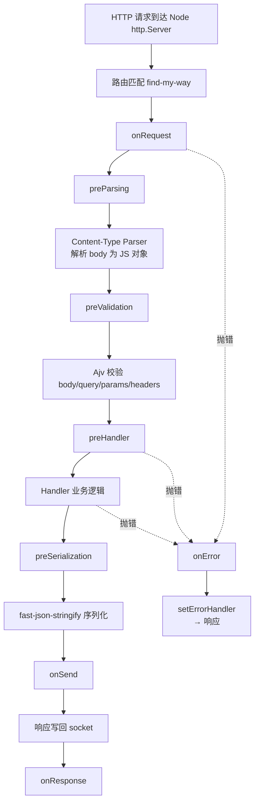
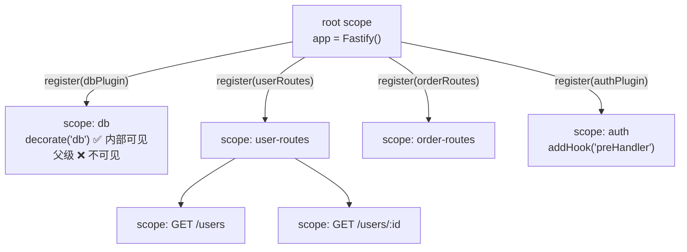
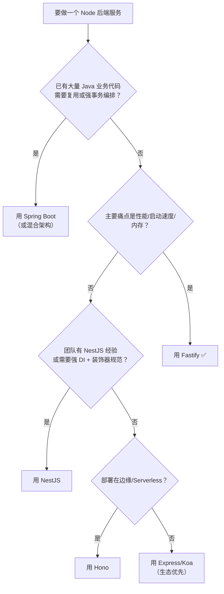
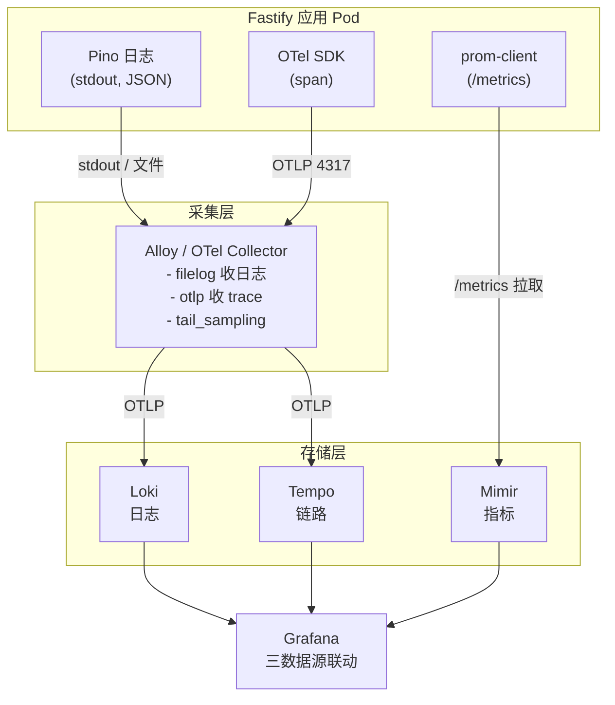

# Fastify 深度教程：从 Spring Boot 到 Node.js 高性能微服务

> **本文读者**：有 Spring Boot / Spring Cloud 工程经验的程序员，熟悉 MVC 分层、IoC 容器、Filter/Interceptor 链、声明式校验、事务边界这些概念。
>
> **本文不做的事**：不解释"什么是 HTTP"、不手把手教 `npm install`、不写 Hello World。
>
> **本文要做的事**：把 Fastify 的每个机制**锚定到你已经掌握的 Spring 概念上**，让你在 1~2 小时内建立完整心智模型，并能在真实项目里做出正确决策。
>
> **版本基线**：`fastify@5.12.x`（2026-10 实测），要求 Node.js ≥ 20。v6 处于 alpha 阶段，本文不涉及。

---

## 目录

- [第 1 章：Fastify 在生态中的位置](#第-1-章fastify-在生态中的位置)
  - [1.1 一句话定位](#11-一句话定位)
  - [1.2 Node 框架横向对比](#12-node-框架横向对比)
  - [1.3 它为什么快：三个关键设计](#13-它为什么快三个关键设计)
  - [1.4 Spring 开发者最该先想清楚的 5 个问题](#14-spring-开发者最该先想清楚的-5-个问题)
- [第 2 章：请求生命周期 —— Fastify 的管线模型](#第-2-章请求生命周期--fastify-的管线模型)
  - [2.1 完整管线](#21-完整管线)
  - [2.2 十个请求级 Hook 与 Spring 的对应关系](#22-十个请求级-hook-与-spring-的对应关系)
  - [2.3 应用级 Hook](#23-应用级-hook)
  - [2.4 在 Hook 中提前响应](#24-在-hook-中提前响应)
  - [2.5 Hook 的作用域规则](#25-hook-的作用域规则)
- [第 3 章：Encapsulation —— Fastify 最独特也最易踩坑的设计](#第-3-章encapsulation--fastify-最独特也最易踩坑的设计)
  - [3.1 作用域树](#31-作用域树)
  - [3.2 Encapsulation 在 Spring 中没有对应物](#32-encapsulation-在-spring-中没有对应物)
  - [3.3 fastify-plugin：打破封装的标准手段](#33-fastify-plugin打破封装的标准手段)
  - [3.4 插件加载顺序与依赖声明](#34-插件加载顺序与依赖声明)
  - [3.5 常见踩坑清单](#35-常见踩坑清单)
- [第 4 章：Schema 驱动的契约 —— 校验、序列化、文档三合一](#第-4-章schema-驱动的契约--校验序列化文档三合一)
  - [4.1 v5 的重要变化：强制完整 JSON Schema](#41-v5-的重要变化强制完整-json-schema)
  - [4.2 请求校验：Ajv 的行为细节](#42-请求校验ajv-的行为细节)
  - [4.3 响应序列化：性能收益与"字段消失"陷阱](#43-响应序列化性能收益与字段消失陷阱)
  - [4.4 共享 Schema 与 $ref](#44-共享-schema-与-ref)
  - [4.5 TypeScript 类型安全：TypeBox + Type Provider](#45-typescript-类型安全typebox--type-provider)
  - [4.6 OpenAPI 文档自动生成](#46-openapi-文档自动生成)
  - [4.7 与 Spring 校验链的对照](#47-与-spring-校验链的对照)
- [第 5 章：错误处理与可观测性](#第-5-章错误处理与可观测性)
  - [5.1 错误处理器的层级语义（实测）](#51-错误处理器的层级语义实测)
  - [5.2 业务异常的统一建模](#52-业务异常的统一建模)
  - [5.3 404 处理](#53-404-处理)
  - [5.4 Pino 日志与请求级 child logger](#54-pino-日志与请求级-child-logger)
  - [5.5 指标、追踪与过载保护](#55-指标追踪与过载保护)
- [第 6 章：依赖注入 —— Fastify 没有 DI 容器](#第-6-章依赖注入--fastify-没有-di-容器)
  - [6.1 三种主流注入模式](#61-三种主流注入模式)
  - [6.2 能力差距对照表](#62-能力差距对照表)
  - [6.3 事务边界放哪里](#63-事务边界放哪里)
  - [6.4 什么时候你该换回 Spring](#64-什么时候你该换回-spring)
- [第 7 章：工程化 —— 项目结构、配置、测试](#第-7-章工程化--项目结构配置测试)
  - [7.1 目录结构](#71-目录结构)
  - [7.2 build 工厂模式](#72-build-工厂模式)
  - [7.3 配置管理](#73-配置管理)
  - [7.4 测试](#74-测试)
  - [7.5 autoload：按目录自动注册路由](#75-autoload按目录自动注册路由)
- [第 8 章：生产实践](#第-8-章生产实践)
  - [8.1 优雅关闭](#81-优雅关闭)
  - [8.2 健康检查与就绪探针](#82-健康检查与就绪探针)
  - [8.3 反向代理下的真实 IP](#83-反向代理下的真实-ip)
  - [8.4 超时、体积限制与连接复用](#84-超时体积限制与连接复用)
  - [8.5 多进程与水平扩展](#85-多进程与水平扩展)
  - [8.6 生产配置检查表](#86-生产配置检查表)
- [第 9 章：与 Spring Cloud 生态集成](#第-9-章与-spring-cloud-生态集成)
  - [9.1 服务注册与发现](#91-服务注册与发现)
  - [9.2 配置中心](#92-配置中心)
  - [9.3 服务间调用](#93-服务间调用)
  - [9.4 熔断限流降级](#94-熔断限流降级)
  - [9.5 用 Fastify 做 BFF / 网关](#95-用-fastify-做-bff--网关)
  - [9.6 链路追踪](#96-链路追踪)
- [第 10 章：选型决策与常见误区](#第-10-章选型决策与常见误区)
  - [10.1 决策树](#101-决策树)
  - [10.2 什么场景不该用 Fastify](#102-什么场景不该用-fastify)
  - [10.3 新人最容易犯的 12 个错](#103-新人最容易犯的-12-个错)
- [第 11 章：可观测性落地 —— Loki + Tempo + Mimir + OpenTelemetry](#第-11-章可观测性落地--loki--tempo--mimir--opentelemetry)
  - [11.1 先建立三个正确认知](#111-先建立三个正确认知)
  - [11.2 数据流全景](#112-数据流全景)
  - [11.3 应用侧改造](#113-应用侧改造)
  - [11.4 单机验证环境（docker compose）](#114-单机验证环境docker-compose)
  - [11.5 Grafana 三件套关联配置](#115-grafana-三件套关联配置)
  - [11.6 生产：Kubernetes 部署](#116-生产kubernetes-部署)
  - [11.7 生产实践要点](#117-生产实践要点)
  - [11.8 Java → Node 心智映射表（速查）](#118-java--node-心智映射表速查)
- [附录 A：Fastify v4 与 v5 迁移要点](#附录-afastify-v4-与-v5-迁移要点)
- [附录 B：核心 API 速查表](#附录-b核心-api-速查表)
- [附录 C：常用插件清单](#附录-c常用插件清单)
- [附录 D：参考资源](#附录-d参考资源)

---

## 第 1 章：Fastify 在生态中的位置

### 1.1 一句话定位

**Fastify 是"Servlet 容器 + Spring MVC 基础设施，但把编译期工作做到极致"的 Node 框架。**

它不是 Spring Boot 的等价物（没有 DI、没有 AOP、没有事务、没有自动装配），而是**一个刻意做减法的框架**：只提供路由 + 生命周期 + 契约 + 插件，其余全部交给生态。

这个"减法"是有代价的，下文会反复出现：**你从 Spring 那里免费获得的东西（依赖注入、AOP、声明式事务、统一异常抽象、配置绑定），在 Fastify 里都要自己搭或者换一种思路。**

另一个必须先说清楚的定位差异：

> **Fastify 的编程模型 ≈ Spring MVC（Servlet），不是 Spring WebFlux（Reactor）。**
>
> Fastify 的 handler 是 `async/await` 函数，运行在 Node 的单线程事件循环上，**没有 reactive streams、没有 backpressure、没有背压驱动的流式处理**（除响应体可以是 Stream 外）。
>
> Spring 开发者最容易犯的错，是看到 `async/await` 就以为像 WebFlux 的 `Mono`。实际上：
>
> - Spring MVC：一个请求一个线程，可阻塞 IO（JDBC）。
> - Spring WebFlux：一个请求一个（虚拟）线程处理事件流，IO 异步不阻塞。
> - Fastify：**一个进程一个 JS 线程**，所有请求共享一个事件循环。IO 异步不阻塞，但**任何同步阻塞（`fs.readFileSync`、大 JSON 解析、CPU 密集计算）都会阻塞全部请求**。
>
> 这意味着 Fastify 的"水平扩容"单位是**进程**，不是线程。一个 Node 进程 ≈ 一个 Tomcat 实例，而不是一个 Tomcat 线程。

### 1.2 Node 框架横向对比

| 维度 | Express | Koa | Fastify | NestJS | Hono |
| --- | --- | --- | --- | --- | --- |
| 心智模型 | 中间件链 | 洋葱模型（async/await 中间件） | 生命周期 Hook + 插件 | 装饰器 + DI 容器 | Fetch API 标准 |
| 性能 | 基准 | 中 | **高** | 中高（底层可用 Fastify） | 极高（尤其边缘运行时） |
| 校验 | 手工 / 第三方 | 手工 | **Schema 驱动（Ajv + fast-json-stringify）** | DTO + class-validator | Schema / Hono Validator |
| DI | 无 | 无 | 无（装饰器模式） | **完整容器** | 无 |
| OpenAPI | 手工 | 手工 | 自动生成 | 自动生成（Swagger 模块） | 手工 |
| 运行时要求 | Node 18+ | Node 18+ | Node 20+ | Node 20+ | 边缘运行时 |
| 适合 | 历史包袱 | 极简中间件 | **高性能服务、BFF、网关** | 大团队、强规范、Java 背景迁移 | 边缘 / Serverless |

**选择逻辑（给 Spring 开发者的翻译）**：

- 想要 "Spring Boot 体验" → NestJS（底层可选 Fastify 适配器）。
- 想要 "Spring Boot Web 但更轻、更快、约束更明确" → **Fastify**。
- 想要 "Netty + Reactor 的极致" → Hono（但生态与 Java 习惯差距更大）。
- 已经在用 Express 且无性能诉求 → 别动。

### 1.3 它为什么快：三个关键设计

理解这三个设计，后面所有的 API 设计都会变得自然。

**① 路由树是 radix tree（`find-my-way`）**

Spring 的 `DispatcherServlet` 靠 `HandlerMapping` + `AntPathMatcher` 做路径匹配，是**逐段字符串比较**。`find-my-way` 预先把路由编译成 radix tree，匹配是**指针跳转**，且**不为每个请求重新解析 URL**（静态路由命中时直接跳过解析）。

参数路由、约束（`/user/:id(\\d+)`）、通配符都在**注册期**编译好，运行期零字符串解析。

**② 序列化和校验都在启动时编译成 JS 函数**

这是 Fastify 最容易被低估的性能来源：

```text
JSON Schema  --ajv 编译-->  校验函数（JS 闭包）
JSON Schema  --fast-json-stringify 编译-->  序列化函数（JS 闭包）
```

请求到来时执行的是**普通 JS 函数调用**，不是"遍历 schema 树做解释"。对比 Spring：

| 环节 | Spring 默认 | Fastify |
| --- | --- | --- |
| 请求校验 | Jakarta Validation，**运行时反射 + 代理** | Ajv 编译后的闭包，**零反射** |
| 响应序列化 | Jackson，**运行时反射 introspect** | fast-json-stringify 编译后的闭包，**生成直写代码** |
| 反射成本 | 首次有缓存，但仍是运行时元数据 | 编译期确定，**GC 压力更小** |

fast-json-stringify 的本质是：**根据 schema 生成一段"手写"的序列化 JS 代码**，直接 `output.push(...)`，而不是通用遍历。所以它能比 `JSON.stringify` 快 2~3 倍，并且**天然丢弃 schema 里没声明的字段**（这既是性能特性，也是安全特性，后面 4.3 节详述）。

**③ 插件加载是拓扑排序的（`avvio`）**

Spring 的 Bean 容器有依赖图解析能力，Fastify 也有 —— `avvio` 会在 `ready()` 前按 `dependencies` 元数据拓扑排序插件加载顺序。这保证了你"装饰器在谁之后可用"是确定的。

### 1.4 Spring 开发者最该先想清楚的 5 个问题

在读 API 之前，先对这 5 个问题给出我的判断：

**Q1：没有 DI 容器，Service 怎么拿到 Repository？**
→ 用**闭包工厂 + 显式传参**，这是 Fastify 社区的主流做法。Fastify 的 `decorate` 是给"实例级基础设施"（db、redis、config）用的，不是通用 DI。详见第 6 章。

**Q2：没有 AOP，事务、日志、鉴权怎么办？**
→ 用 **Hook**（Fastify 的 AOP 等价物，且切点比 Spring 更细）。`preHandler` 钩子做鉴权/权限，`preSerialization` 做统一包装。真正需要"织入方法"的能力（@Transactional）应该下沉到 Repository 层显式管理。详见 6.3。

**Q3：没有 `@RestControllerAdvice`，全局异常怎么办？**
→ `app.setErrorHandler()`，而且它**遵循封装作用域**：子作用域可以覆盖父作用域的错误处理器（实测见 5.1），这比 Spring 的 `@Order` + `if` 判断更干净。

**Q4：Spring Cloud 那套（注册中心、配置中心、Gateway）能接上吗？**
→ 能。Node 侧有 Nacos/Consul/Eureka 客户端、有配置中心 SDK、有 OpenTelemetry。详见第 9 章。

**Q5：数据校验怎么做？DRO 和 `@Valid` 那一套没了？**
→ 换成 **JSON Schema 声明式契约**。这是 Fastify 的核心设计哲学：**契约写在路由上，一次声明同时产出校验、序列化、TypeScript 类型、OpenAPI 文档**。详见第 4 章。

---

## 第 2 章：请求生命周期 —— Fastify 的管线模型

### 2.1 完整管线

Fastify 没有 `DispatcherServlet`，但它有一条**比 Spring MVC 更细粒度**的管线。理解这张图，后面的 API 都是自然结果：



注意这条管线**不是 Servlet Filter 那种"套娃"结构**，而是**扁平的顺序阶段**。这是 Fastify 与 Spring 最大的 API 差异：

- Spring：`Filter → DispatcherServlet → Interceptor.preHandle → Handler → Interceptor.postHandle → afterCompletion → Filter`
- Fastify：一条线，10 个命名阶段，每个阶段可以选择"安装一个全局函数"或"每个路由一个函数"。

### 2.2 十个请求级 Hook 与 Spring 的对应关系

| Fastify Hook | 执行时机 | Spring 中的近似对应物 | 典型用途 |
| --- | --- | --- | --- |
| `onRequest` | 收到请求，**body 还未解析** | `Filter#doFilter` 前半段 / `OncePerRequestFilter` | 认证、限流、traceId 注入、early return |
| `preParsing` | body 解析**之前**，拿到原始流 | `Filter` 中处理 body 流 | 解压、加密报文解包、协议转换 |
| `preValidation` | 解析完成、**校验之前** | `HandlerInterceptor#preHandle`（部分） | 参数归一化、补默认值 |
| `preHandler` | 校验通过、**handler 之前** | `HandlerInterceptor#preHandle` | 鉴权、权限、资源加载 |
| `preSerialization` | handler 返回后、**序列化之前** | `ResponseBodyAdvice#beforeBodyWrite` | 统一响应包装、字段脱敏 |
| `onError` | 出错时，**在 errorHandler 之前** | `HandlerExceptionResolver` | 统一错误日志、补充 header |
| `onSend` | payload 序列化后、**写 socket 前** | `Filter` 中包装 `HttpServletResponse` | 压缩、注入 header、审计 |
| `onResponse` | 响应**已发出** | `Filter#doFilter` 的 finally / `afterCompletion` | 耗时统计、埋点上报 |
| `onTimeout` | socket 级超时 | — | 连接超时监控 |
| `onRequestAbort` | 客户端提前断开 | — | 取消正在进行的昂贵查询 |

**三个 Spring 开发者会立刻发现的增强点**：

1. **切点比 `HandlerInterceptor` 细得多**。Spring 的 `HandlerInterceptor` 只有 preHandle/postHandle/afterCompletion 三个点，且拿不到"body 还没解析"和"序列化前"的时机。Fastify 有 10 个点，能实现"响应序列化前统一脱敏""body 解析前解压"这类需求，而不需要 `Filter` + `ResponseBodyAdvice` 两套机制。

2. **Hook 可以按路由安装**。Spring 的 `@Interceptor` 是全局的 + `HandlerMapping` 过滤；Fastify 可以：

```ts
// 全局
app.addHook('preHandler', authHook)

// 单路由
app.get('/public', { preHandler: [] }, handler)          // 显式清空
app.get('/admin', { preHandler: [authHook, adminHook] }, handler)  // 局部追加
```

路由级 hook 是**追加**到作用域 hook 之后的（不是替换）。

3. **`onError` 不能改错误**。它是纯观测点。想改错误内容请在 `setErrorHandler` 里做。

### 2.3 应用级 Hook

| Hook | 时机 | 用途 |
| --- | --- | --- |
| `onReady` | 所有插件加载完、开始 listen 前 | 预热缓存、连接数据库、加载配置 |
| `onListen` | 端口绑定成功后 | 注册到注册中心、上报存活 |
| `onClose` | `app.close()` 时 | 关闭连接池、注销注册中心 |
| `preClose` | `onClose` 之前 | 停止接收新流量 |
| `onRoute` | 每条路由注册时 | 路由级审计、自动加鉴权、生成文档 |
| `onRegister` | 每个插件注册时 | 插件级审计、依赖检查 |

`onRoute` 是 Fastify 的一个特色钩子，Spring 里没有直接对应物：

```ts
app.addHook('onRoute', (routeOptions) => {
  // 统一给所有路由打标签、挂 metrics、强制 schema
  console.log(`注册路由: ${routeOptions.method} ${routeOptions.url}`)
})
```

### 2.4 在 Hook 中提前响应

和 Spring Filter 里的"短路返回"一样，Fastify 允许在 hook 中直接 `reply.send()`，此时**后续所有 hook 和 handler 都被跳过**：

```ts
app.addHook('onRequest', async (req, reply) => {
  const token = req.headers.authorization
  if (!token) {
    reply.code(401).send({ error: 'unauthorized' })
    return reply   // ⚠️ 必须 return，否则请求会继续执行
  }
})
```

> ⚠️ **最高频的坑**：在 `async` hook 里调用 `reply.send()` 后**必须 `return reply`**。
>
> 原因：`reply.send()` 是**同步**发起响应（写入 socket 是异步的），但 `async` 函数返回 `undefined` 会让 Fastify 认为"hook 正常结束，继续走"，导致 handler 被再次执行，最终抛出 `FST_ERR_REP_ALREADY_SENT`。
>
> 官方文档特别强调：**不要混用 callback 风格（`done`）和 async/Promise 风格**，否则 hook 链会被执行两次。

另外注意 `done` 回调在 async 函数里不可用：`done` 回调与 `async/await` **不要混用**。

### 2.5 Hook 的作用域规则

Hook 遵循封装作用域规则（下一章详述）：

- 在 root 注册的 hook → **对所有子作用域的路由生效**。
- 在子作用域注册的 hook → **只对该作用域内的路由生效**，且与父级 hook **按注册顺序串联执行**（父先子后）。
- 子作用域**不能移除**父级的 hook，只能在自己的路由上用 `preHandler: []` 之类做路由级覆盖。

---

## 第 3 章：Encapsulation —— Fastify 最独特也最易踩坑的设计

### 3.1 作用域树

`app.register(plugin)` **总是创建一个新的作用域**。新作用域里：

- `decorate` 添加的属性 → **只在该作用域及其子作用域可见**
- `addHook` 添加的 hook → **只对该作用域内的路由生效**
- `addSchema` 添加的 schema → 同上
- 路由 → 属于该作用域



实测验证（Fastify 5.12.x）：

```ts
const app = Fastify()
app.register(async (inst) => {
  inst.decorate('secret', 'child-only')
})
// await app.ready()
console.log(app.hasDecorator('secret'))  // false ← 父级看不到
```

### 3.2 Encapsulation 在 Spring 中没有对应物

这是最难迁移的心智障碍。Spring 的世界是**扁平的**：所有 Bean 在同一个容器里，`@Autowired` 全局可见，没有"私有作用域"的概念。

Fastify 的作用域树带来的是**真正的模块隔离**，最接近的类比是：

| 场景 | Spring 中的对应物 |
| --- | --- |
| 插件私有依赖（不希望泄漏） | Spring 里只能靠包名约定 + `@ConditionalOnMissingBean`；Fastify 是**语言级强制** |
| 模块化单体（Modular Monolith） | Fastify 天然支持；Spring 要靠 `spring.modulith` 或 Maven 多模块 |
| 多租户 | 靠作用域给每个租户注入不同的 db 实例 |

**但代价也很明显**：Spring 里 `@Autowired` 一定能拿到；Fastify 里"父级拿不到子级的 decorator"是**默认行为而非异常**，很多人在这里浪费半天。

### 3.3 fastify-plugin：打破封装的标准手段

当你希望一个插件的能力**扩散到父作用域**（比如注入 db、redis、config），用 `fastify-plugin` 包裹：

```ts
import fp from 'fastify-plugin'

export default fp(async (app, opts) => {
  app.decorate('db', createPool(opts.connectionString))
  app.addHook('onClose', async () => { await app.db.end() })
}, {
  name: 'db-plugin',
  fastify: '5.x',
})
```

`fastify-plugin` 的本质是设置 `Symbol.for('skip-override')`，让 avvio **不创建新作用域**，插件在父作用域上执行。

> ⚠️ **不要用** `plugin[Symbol.for('skip-override')] = true` 手写这个标记（虽然官方文档提过，但明确不推荐）：`fastify-plugin` 还能做 Fastify 版本兼容性校验，未来 API 变更由它兜底。

**判断标准**：

| 场景 | 是否 `fp` 包裹 |
| --- | --- |
| 提供基础设施（db / redis / config / logger 增强） | ✅ 包裹 |
| 提供一组路由 + 路由私有 hook | ❌ 不包裹（保持隔离） |
| 提供一组路由，但希望 hook 覆盖全应用 | ✅ 包裹（此时要注意 hook 泄漏影响面） |
| 纯工具函数 | ❌ 直接导出函数即可，不用做成插件 |

> ⚠️ **注意**：`fp` 包裹的插件如果同时注册了路由，`prefix` 选项会**失效**（因为没有新作用域来挂前缀）。需要前缀就用不包裹的版本。

### 3.4 插件加载顺序与依赖声明

`avvio` 会按依赖元数据做拓扑排序：

```ts
app.register(async (inst) => {
  inst.decorate('config', loadConfig())
}, { dependencies: ['env'] })

app.register(async (inst) => {
  // 能安全使用 inst.config，因为 env 先加载
  const cfg = inst.config
}, { dependencies: ['env'] })
```

命名插件才能被依赖：

```ts
export default fp(async (app) => { /* ... */ }, { name: 'env' })
```

**顺序也是依赖的一种表达**：`register` 是顺序执行的，前一个插件的装饰器对后一个可见（因为后者的 `opts` 函数参数拿到的实例已包含前面的装饰器）。但**不要依赖隐式顺序**，用 `dependencies` 显式声明。

### 3.5 常见踩坑清单

| 现象 | 原因 | 解法 |
| --- | --- | --- |
| `app.db` is undefined | 插件未用 `fp` 包裹，装饰器没上浮 | 用 `fp` 包裹，或在插件内把 db 通过 `opts` 传给子插件 |
| `instance.xyz is not a function` | 父级在子作用域外访问子作用域装饰器 | 同上 |
| `fastify.register` 后立刻 `app.get` 找不到路由 | 插件是异步加载的，`register` 返回时插件还没执行 | 用 `await app.ready()`；或 `app.after()` |
| `prefix` 没生效 | 插件被 `fp` 包裹 | 去掉 `fp`，或手动在插件内拼路径 |
| hook 影响了不该影响的路由 | hook 注册在了 root 作用域 | 移到具体子作用域注册 |

---

## 第 4 章：Schema 驱动的契约 —— 校验、序列化、文档三合一

### 4.1 v5 的重要变化：强制完整 JSON Schema

Fastify v5 移除了 `jsonShortHand` 选项，`querystring` / `params` / `body` / `response` **必须写完整 JSON Schema**（必须含 `type: 'object'` 和 `properties`）：

```ts
// ❌ v4 写法，v5 会报错
schema: { querystring: { name: { type: 'string' } } }

// ✅ v5 写法
schema: {
  querystring: {
    type: 'object',
    properties: { name: { type: 'string' } },
    required: ['name'],
  },
}
```

> **为什么改？** 因为要兼容 Zod 等其他校验库、让 `@fastify/swagger` 能正确推断参数类型、消除歧义。对使用者是好事，但你从网上抄的 v4 教程会直接报错。

### 4.2 请求校验：Ajv 的行为细节

Fastify 内置 Ajv v8，基线配置如下（**这几个默认值会直接影响你的业务语义，必须知道**）：

```js
{
  coerceTypes: 'array',   // 类型强制
  useDefaults: true,      // 用 schema 里的 default 填充缺失字段
  removeAdditional: true, // 删除 schema 未声明的字段（当 additionalProperties 为 false 时）
  allErrors: false,       // 只报第一个错误（安全考虑，避免 DoS）
}
```

**`coerceTypes: 'array'` 的含义**：query string 里所有值都是字符串，所以

```text
?ids=1&ids=2   →  { ids: ['1', '2'] }
?ids=1        →  { ids: ['1'] }      // 注意：不是标量
?active=true  →  { active: true }    // boolean 被强制转换
?page=2       →  { page: 2 }         // number 被强制转换
```

这跟 Spring 的 `WebDataBinder` + `ConversionService` 行为一致（`List<Long> ids` 也能从 `ids=1&ids=2` 绑定），心智上可以无缝迁移。

**⚠️ 副作用 1：`removeAdditional: true`**

当 schema 声明了 `additionalProperties: false` 时，**未声明的请求字段会被静默删除**。这意味着：

```ts
schema: {
  body: {
    type: 'object',
    additionalProperties: false,
    properties: { name: { type: 'string' } },
  }
}
```

客户端传 `{ name: 'x', isAdmin: true }` → `req.body.isAdmin` **不存在**（不是报错，是被删了）。安全上没问题，但如果你的业务期望"拒绝未知字段"，需要自己在 `preValidation` 里检查或改用 `allErrors` + 自定义错误处理。

**⚠️ 副作用 2：`allErrors: false`**

校验失败只返回**第一个**错误，不是全部。这是为了防 DoS（大量错误信息本身是攻击面）。Spring 的 `@Valid` 默认也是 fail-fast（收集第一个错误就抛），行为一致；但如果你用 `jakarta.validation` 的 `Errors` 对象收集全部错误，语义就不同了。

**⚠️ 副作用 3：Ajv 的 `anyOf` + `coerceTypes` 有坑**

```ts
// ❌ 危险：0 和 false 会被强制转成 null
{ anyOf: [{ type: 'null' }, { type: 'number' }] }

// ✅ 用 nullable
{ type: 'number', nullable: true }
```

### 4.3 响应序列化：性能收益与"字段消失"陷阱

声明 `response` schema 后，Fastify 用 `fast-json-stringify` 序列化。**这个 schema 是白名单**：

```ts
const Order = {
  type: 'object',
  properties: {
    id: { type: 'string' },
    total: { type: 'number' },
  },
}

app.get('/orders/:id', {
  schema: { response: { 200: Order } },
}, async () => {
  return {
    id: 'o-1',
    total: 99,
    internalCost: 42,     // ← 这个字段不会出现在响应里
    password: 'secret',   // ← 同上，永远不会泄漏
  }
})
```

响应体只有 `{"id":"o-1","total":99}`。

**这是特性不是 bug**，而且是**安全收益**：即使你在 Repository 里 `SELECT *`，实体上带着 `password_hash`、`deleted_at` 等敏感字段，Fastify 的响应 schema 会在序列化层把它们全部拦掉。这比"记得在 DTO 上打 `@JsonIgnore`"可靠得多。

**但要警惕**：如果你的响应 schema 写漏了字段，**前端拿不到，且没有任何报错**。类型系统能帮你发现（见 4.5），但纯 JS 项目里这是个常见事故源。

**另一个细节**：响应 schema 按**状态码**组织：

```ts
schema: {
  response: {
    200: SuccessSchema,
    404: ErrorSchema,
    '2xx': AnySuccessSchema,   // 匹配所有 2xx
    default: ErrorSchema,      // 兜底
  }
}
```

序列化函数是**按状态码缓存编译**的（用 `WeakMap`），所以不同状态码用不同 schema 不会互相干扰。

**Content-Type 级别的响应 schema**（多格式响应）：

```ts
response: {
  200: {
    content: {
      'application/json': { schema: JsonSchema },
      'application/vnd.v1+json': { schema: V1Schema },
    }
  }
}
```

### 4.4 共享 Schema 与 $ref

```ts
// 定义一次
app.addSchema({
  $id: 'Order',
  type: 'object',
  properties: {
    id: { type: 'string' },
    items: { type: 'array', items: { $ref: 'OrderItem#' } },
  },
})

app.addSchema({
  $id: 'OrderItem',
  type: 'object',
  properties: { sku: { type: 'string' }, qty: { type: 'integer' } },
})

// 引用
app.get('/orders', {
  schema: { response: { 200: { $ref: 'Order#' } } },
}, handler)
```

`$ref` 解析规则：

| 写法 | 含义 |
| --- | --- |
| `{ $ref: 'Order#' }` | 引用 `$id: 'Order'` 的 schema 根 |
| `{ $ref: 'Order#/properties/id' }` | 引用其某个子字段 |
| `{ $ref: '#Order' }` | 当前作用域内 `$id: '#Order'` 的 schema |
| `{ $ref: '#/$defs/foo' }` | 当前 schema 内 `$defs.foo` |

`addSchema` 也是**作用域隔离**的：子作用域可以引用父作用域的 schema，反之不行。

### 4.5 TypeScript 类型安全：TypeBox + Type Provider

这是 Fastify v5 最实用的改进之一：**Schema 即类型源**。

```ts
import { Type, type Static } from '@sinclair/typebox'
import { TypeBoxTypeProvider } from '@fastify/type-provider-typebox'

const app = Fastify({ logger: true }).withTypeProvider<TypeBoxTypeProvider>()

const OrderItem = Type.Object({
  sku: Type.String(),
  qty: Type.Integer(),
})

const CreateOrder = Type.Object({
  userId: Type.Integer(),
  items: Type.Array(OrderItem),
  coupon: Type.Optional(Type.String()),
})

// 类型导出，供业务层复用
export type CreateOrderDto = Static<typeof CreateOrder>

app.post('/orders', {
  schema: {
    body: CreateOrder,
    response: {
      201: Type.Object({
        id: Type.String(),
        total: Type.Number(),
      }),
    },
  },
}, async (req, reply) => {
  req.body.userId     // ✅ number
  req.body.items[0].sku  // ✅ string
  req.body.coupon     // ✅ string | undefined

  reply.code(201)
  return { id: 'o-1', total: 100 }
})
```

**收益**：

- `req.body` / `req.query` / `req.params` **自动推导类型**，零手写 DTO、零 `as` 断言。
- 校验、序列化、类型、OpenAPI 文档**四处同源**，不会漂移。
- v5 起 type provider 把类型拆成了 `validator` 与 `serializer` 两套（因为 v5 允许二者用不同 schema），用 TypeBox 时两者一致。

> **注意**：v5 中如果你的自定义 type provider 还是 v4 的写法（只有 `input`/`output`），需要改成 `validator` / `serializer`。`@fastify/type-provider-typebox` 和 `@fastify/type-provider-json-schema-to-ts` 的最新版本已经适配。

**不想引入 TypeBox？** 也有纯 JSON Schema + `json-schema-to-ts` 的方案：

```ts
import { FromSchema } from 'json-schema-to-ts'
import { JsonSchemaToTsProvider } from '@fastify/type-provider-json-schema-to-ts'

const app = Fastify().withTypeProvider<JsonSchemaToTsProvider>()
type Body = FromSchema<typeof bodySchema>
```

### 4.6 OpenAPI 文档自动生成

```ts
import swagger from '@fastify/swagger'
import swaggerUi from '@fastify/swagger-ui'

await app.register(swagger, {
  openapi: {
    openapi: '3.1.0',
    info: { title: 'Order Service', version: '1.0.0' },
    components: {
      securitySchemes: {
        bearerAuth: { type: 'http', scheme: 'bearer', bearerFormat: 'JWT' },
      },
    },
  },
})

await app.register(swaggerUi, { routePrefix: '/docs' })
```

**关键点**：

- `@fastify/swagger` **必须先于所有路由注册**（否则发现不到路由）。
- 版本兼容：`@fastify/swagger` ≥ 9.x 对应 Fastify 5.x；≥7 <9 对应 Fastify 4.x。
- schema 里的 `description` / `summary` / `tags` 会被写入 OpenAPI。
- 需要前端展示可另加 `@fastify/swagger-ui` 或 `@scalar/fastify-api-reference`。

**版本对照（容易踩坑）**：

| Fastify | @fastify/swagger | @fastify/type-provider-typebox |
| --- | --- | --- |
| 5.x | ≥ 9.x | ≥ 5.x（适配 v5 类型拆分） |
| 4.x | ≥ 7.x < 9.x | 4.x |

### 4.7 与 Spring 校验链的对照

| Spring | Fastify | 备注 |
| --- | --- | --- |
| `@Valid @RequestBody` + `jakarta.validation` | `schema.body` + Ajv | Fastify 内置，无需 starter |
| `@NotBlank @Size @Min` 等注解 | JSON Schema 关键字（`minLength` / `minimum` / `pattern`） | 声明式程度更高 |
| `@Valid` on `@RequestParam` | `schema.querystring` |  |
| `@PathVariable` 校验 | `schema.params` |  |
| `@InitBinder` + `ConversionService` | Ajv `coerceTypes` | 行为相近 |
| `springdoc-openapi` | `@fastify/swagger` |  |
| Jackson `@JsonInclude` / `@JsonIgnore` | `response` schema 白名单 | Fastify 方式更可靠 |
| `@RestControllerAdvice` + `MethodArgumentNotValidException` | `setErrorHandler` + `error.validation` |  |

**迁移的心智调整**：

- 注解 → JSON Schema：字段约束从注解挪到 schema，**和路由定义在一起**（不是和 DTO 放一起）。
- DTO 类 → TypeBox schema：DTO 的"运行时校验 + 类型"职责合并为一个 schema 对象。
- Fastify 的校验发生在**路由层**，而 Spring 的校验发生在**参数解析层**。结果一样，但 Fastify 更快（无反射）。

---

## 第 5 章：错误处理与可观测性

### 5.1 错误处理器的层级语义（实测）

`setErrorHandler` **遵循封装作用域**。这是实测结果（fastify 5.12.7）：

```ts
const app = Fastify()
app.setErrorHandler((err, req, reply) => reply.code(500).send({ where: 'root' }))

app.register(async (inst) => {
  inst.setErrorHandler((err, req, reply) => reply.code(500).send({ where: 'child' }))
  inst.get('/boom', async () => { throw new Error('x') })
})
app.get('/boom-root', async () => { throw new Error('x') })

// GET /boom      → {"where":"child"}   ← 子作用域的错误处理器
// GET /boom-root  → {"where":"root"}    ← 根作用域的错误处理器
```

**这是 Spring 做不到的干净**：Spring 里全局只有一个 `@RestControllerAdvice`，要实现"某个模块特殊处理"得靠 `@Order` + `instanceof` 判断 + `handler.getBeanType()` 之类的 hack。Fastify 里就是**作用域继承 + 覆盖**，天然干净。

> ⚠️ **注意**：如果你在**根作用域**注册了 `setErrorHandler`，它对所有子作用域生效（除非子作用域覆盖）。这跟 Spring 全局 Advice 的直觉一致。

### 5.2 业务异常的统一建模

Fastify 的错误处理核心约定：**错误对象上带 `statusCode`**。

```ts
// 定义业务异常
export class BizError extends Error {
  constructor(
    public readonly code: string,
    message: string,
    public readonly statusCode = 400,
    public readonly details?: unknown,
  ) {
    super(message)
    this.name = 'BizError'
  }
}

// 全局错误处理
app.setErrorHandler((error, request, reply) => {
  request.log.error({ err: error }, 'request failed')

  if (error instanceof BizError) {
    return reply.code(error.statusCode).send({
      code: error.code,
      message: error.message,
      details: error.details,
    })
  }

  // 校验错误（400）
  if (error.validation) {
    return reply.code(400).send({
      code: 'VALIDATION_ERROR',
      message: `invalid ${error.validationContext}`,
      details: error.validation,
    })
  }

  // 其余一律 500，不暴露内部信息
  return reply.code(500).send({ code: 'INTERNAL_ERROR', message: 'Internal Server Error' })
})
```

关键属性：

| 属性 | 说明 |
| --- | --- |
| `error.statusCode` | 校验错误固定为 400；自定义错误由你设置 |
| `error.validation` | 校验失败的详情（Ajv 错误数组） |
| `error.validationContext` | `'body' \| 'querystring' \| 'params' \| 'headers'` |
| `error.code` | Fastify 内置错误码，如 `FST_ERR_CTP_BODY_TOO_LARGE` |

**推荐用 `@fastify/sensible`**（Fastify 官方维护）替代手写异常类，它提供了 `httpErrors.notFound()`、`badRequest()` 等一整套：

```ts
import sensible from '@fastify/sensible'
app.register(sensible)
app.get('/:id', async (req) => {
  if (!await exists(req.params.id)) {
    throw app.httpErrors.notFound('order not found')
  }
})
```

### 5.3 404 处理

```ts
app.setNotFoundHandler((request, reply) => {
  reply.code(404).send({
    code: 'NOT_FOUND',
    message: `Route ${request.method} ${request.url} not found`,
  })
})
```

`setNotFoundHandler` 同样遵循作用域规则。

### 5.4 Pino 日志与请求级 child logger

Fastify 内置 Pino（不是可选的）。v5 起，**自定义 logger 实例必须用 `loggerInstance`**，`logger` 选项只接受配置对象：

```ts
// ❌ v4 写法，v5 不再支持
const logger = pino()
Fastify({ logger })

// ✅ v5
Fastify({ loggerInstance: pino({ level: 'info' }) })
```

**每个请求自带一个带绑定字段的 child logger**，这是 Fastify 的杀手锏之一：

```ts
app.addHook('onRequest', async (req, reply) => {
  req.log.info('incoming request')   // 自动带上 reqId
})

app.get('/:id', async (req) => {
  req.log.info({ orderId: req.params.id }, 'loading order')
  // 输出：{"reqId":"req-3","orderId":"o-1","msg":"loading order", ...}
})
```

`reqId` 默认自动生成（`req-1`、`req-2`…），也可以自定义：

```ts
Fastify({ genReqId: (req) => req.headers['x-request-id'] as string })
```

**对比 Spring 的 SLF4J MDC**：Fastify 的 child logger 是**对象级别的**，不需要手动 put/remove；MDC 方案在异步/协程场景下容易串味，Fastify 没这个问题。

**开发环境美化输出**：

```ts
Fastify({
  logger: {
    transport: { target: 'pino-pretty' },
  },
})
```

### 5.5 指标、追踪与过载保护

> 📖 本节只给能力对照表。**完整的可观测性落地（Loki + Tempo + Mimir + OTel Collector 装配、单机验证栈、K8s 生产部署、采样与脱敏策略）见 [第 11 章](#第-11-章可观测性落地--loki--tempo--mimir--opentelemetry)**，那一章的所有配置都在本地真实跑通验证过。

| 能力 | Fastify 方案 | Spring 对应 |
| --- | --- | --- |
| 指标 | `prom-client` + 自写 hook | Micrometer + Actuator |
| 追踪 | `@opentelemetry/instrumentation-fastify` | Micrometer Tracing |
| 日志关联 traceId | `@opentelemetry/instrumentation-pino` | `TracingAwareLogDecorator` |
| 过载保护 | `@fastify/under-pressure`（事件循环延迟超阈值返回 503） | 无直接对应（Tomcat 自带线程池排队） |
| 请求 ID | 内置 `reqId`（**与 traceId 无关**，见 11.3.4） | Micrometer Tracing / Sleuth |
| 优雅关闭 | `app.close()` + `onClose` hook | `server.shutdown()` + `@PreDestroy` |

**`@fastify/under-pressure` 值得单独说**：Node 单线程的致命问题是一次 CPU 密集操作会阻塞所有请求。这个插件监控事件循环延迟，超过阈值时直接返回 503，保护自己在雪崩中存活。**生产环境强烈建议开启**。

```ts
app.register(underPressure, {
  maxEventLoopDelay: 1000,  // ms
  maxHeapUsedBytes: 400 * 1024 * 1024,
  retryAfter: 50,
})
```

---

## 第 6 章：依赖注入 —— Fastify 没有 DI 容器

### 6.1 三种主流注入模式

**模式 A：闭包工厂（最常用，推荐）**

```ts
// src/routes/orders.ts
export function orderRoutes(service: OrderService) {
  return async function (app: FastifyInstance) {
    app.get('/', async (req) => service.list(req.query))
    app.get('/:id', async (req) => service.get(req.params.id))
  }
}

// src/app.ts
app.register(orderRoutes(orderService))
```

优点：依赖显式、可测（直接传 mock）、无魔法。对应 Spring 里的"构造器注入"，只是把 Spring 容器承担的"组装"工作交给了**代码本身**。

**模式 B：装饰器（用于基础设施）**

```ts
import fp from 'fastify-plugin'

export interface Db {
  query<T>(sql: string, params?: unknown[]): Promise<T[]>
}

// TypeScript 类型增强，让 app.db 有类型
declare module 'fastify' {
  interface FastifyInstance {
    db: Db
  }
}

export default fp(async (app, opts: { url: string }) => {
  const pool = new Pool({ connectionString: opts.url })
  app.decorate('db', {
    query: async (sql, params) => (await pool.query(sql, params)).rows,
  })
  app.addHook('onClose', async () => { await pool.end() })
}, { name: 'db' })
```

用的时候：

```ts
app.db.query('select * from orders where id = $1', [id])
```

**模式 C：插件 + `opts` 传参（推荐的可测试方式）**

```ts
// plugins/repositories.ts
export default fp(async (app, opts: { db: Db }) => {
  app.decorate('orders', new OrderRepository(opts.db))
}, { name: 'repositories', dependencies: ['db'] })
```

### 6.2 能力差距对照表

| Spring 能力 | Fastify 是否有替代 | 现实答案 |
| --- | --- | --- |
| 构造器注入 | ❌ | 用闭包工厂，手动传参 |
| `@Autowired` / `@Qualifier` | ❌ | 用 `decorate` + `opts`，语义更简单但更显式 |
| Bean 生命周期（`@PostConstruct`） | ⚠️ | 手动在插件里 `await` 初始化；`onReady` hook 是全局版本 |
| `@Profile` | ⚠️ | 用环境变量判断 |
| AOP（`@Aspect`） | ⚠️ | 用 hook（但只能切请求边界，切不到方法内部） |
| `@Transactional` | ❌ | Repository 层显式管理（见 6.3） |
| `@ConfigurationProperties` | ⚠️ | `@fastify/env`（基于 TypeBox 的环境变量校验） |
| `@RestControllerAdvice` | ✅ | `setErrorHandler`（且支持作用域覆盖） |
| `@PreAuthorize` | ⚠️ | `preHandler` hook 或自建装饰器 |
| 自动装配 Starter | ⚠️ | 插件 + `fp`，但需要自己写装配逻辑 |
| 循环依赖检测 | ❌ | 自己避免；Fastify 没有容器也就没有这个问题 |
| AOP 事务传播（`REQUIRES_NEW`） | ❌ | 显式 API 调用 |

### 6.3 事务边界放哪里

Spring 开发者最容易在 Fastify 里踩的坑，是**试图用 hook 实现事务**。

**错误做法**：

```ts
// ❌ 不要这样做
app.addHook('preHandler', async (req, reply) => {
  await db.begin()
  reply.addHook('onResponse', async () => { await db.commit() })
})
```

原因：
1. `onResponse` 在响应**已经发给客户端之后**才执行，事务提交失败时你已经返回 200 了。
2. 响应是流式/长连接时，事务边界完全失控。

**正确做法：事务在 Repository / Service 的显式方法里**。

```ts
export class OrderService {
  constructor(private readonly db: Db) {}

  async create(dto: CreateOrderDto): Promise<Order> {
    return this.db.transaction(async (tx) => {
      const [order] = await tx.query('insert into orders(...) values(...)', [...])
      await tx.query('insert into order_items(...) values(...)', [...])
      return order
    })
  }
}
```

**原则**：**事务边界 = 业务用例边界 = Service 方法边界**。这和 Spring 的 `@Transactional` 加在 Service 上其实是同一个理念，只是 Fastify 里没有 AOP，所以要显式调用。

如果确实想要注解式体验，可以引入 `tsyringe` / `typedi` 做 DI，但**不要同时用装饰器和 AOP 织入**——Fastify 的 hook 体系已经能覆盖大部分横切需求，引入 AOP 反而增加心智负担。

### 6.4 什么时候你该换回 Spring

**如果你的项目具备以下特征，Java/Spring 可能仍是更好的选择**：

- 团队没有 Node 经验，但有深厚 Java 经验（学习成本 > 性能收益）。
- 业务复杂度高、大量领域建模和事务编排（Spring 的事务抽象更成熟）。
- 需要连接大量只提供 Java SDK 的中间件/厂商产品。
- 已有大量 Java 业务代码需要复用。

**Fastify 的优势场景**：

- 需要高吞吐/低延迟的**网关、BFF、聚合层**。
- 轻量微服务（Go 那种"小而美"），需要**启动快、内存小**的镜像。
- Serverless / 边缘部署。
- 与前端同构（TypeScript 全栈，共享类型定义）。

---

## 第 7 章：工程化 —— 项目结构、配置、测试

### 7.1 目录结构

推荐结构（对应 Spring Boot 的分层，但按 Fastify 的插件/作用域组织）：

```text
my-service/
├── src/
│   ├── app.ts                 # buildApp 工厂：装配一切
│   ├── server.ts              # 启动入口：读配置、listen、优雅关闭
│   ├── config/
│   │   ├── env.ts             # @fastify/env 配置校验
│   │   └── index.ts
│   ├── plugins/
│   │   ├── db.ts              # fp 包裹，decorate('db')
│   │   ├── auth.ts            # fp 包裹，addHook('preHandler')
│   │   └── observability.ts   # OTel / metrics
│   ├── modules/               # ★ 业务模块 = 一个作用域
│   │   ├── orders/
│   │   │   ├── routes.ts      # 插件：注册该模块的路由
│   │   │   ├── service.ts     # 业务逻辑
│   │   │   ├── repository.ts  # 数据访问
│   │   │   └── schemas.ts     # TypeBox schemas
│   │   └── users/
│   │       └── ...
│   ├── common/
│   │   ├── errors.ts          # BizError
│   │   └── types.ts
│   └── types/
│       └── fastify.d.ts       # 类型增强（decorate 的类型声明）
├── tests/
│   ├── orders.test.ts
│   └── helpers.ts
├── package.json
├── tsconfig.json
└── Makefile
```

**关键设计**：`modules/` 下的每个目录是一个**独立的作用域**。模块内部的 hook、装饰器不会泄漏到其他模块。这天然实现了**模块化单体（Modular Monolith）**。

### 7.2 build 工厂模式

这是 Fastify 工程化**最重要的一个约定**：把应用构建和进程启动分开。

```ts
// src/app.ts
import Fastify, { type FastifyInstance } from 'fastify'
import dbPlugin from './plugins/db'
import { orderRoutes } from './modules/orders/routes'

export interface BuildOptions {
  logger?: boolean
  dbUrl?: string
}

export async function buildApp(opts: BuildOptions = {}): Promise<FastifyInstance> {
  const app = Fastify({
    logger: opts.logger ?? true,
    trustProxy: true,
  })

  // 错误处理放最前
  app.setErrorHandler(errorHandler)

  // 基础设施
  await app.register(dbPlugin, { url: opts.dbUrl })

  // 业务模块
  await app.register(orderRoutes({ db: app.db }))

  return app
}
```

```ts
// src/server.ts
import { buildApp } from './app'

const app = await buildApp({ logger: true })

await app.listen({ port: Number(process.env.PORT ?? 3000), host: '0.0.0.0' })
```

**为什么这么写**：

- 测试可以 `buildApp({ logger: false })` 拿到一个干净的实例，用 `inject()` 直接打请求，**不需要真的监听端口**（对应 Spring 的 `@SpringBootTest` + `MockMvc`）。
- 启动逻辑只有一份，不会出现"测试环境和生产环境启动方式不同"的经典问题。

### 7.3 配置管理

用 `@fastify/env` 做**带校验的配置**（对应 `@ConfigurationProperties` + `@Validated`）：

```ts
import env from '@fastify/env'
import { Type } from '@sinclair/typebox'

await app.register(env, {
  schema: {
    type: 'object',
    properties: {
      NODE_ENV: { type: 'string', default: 'development' },
      PORT: { type: 'integer', default: 3000 },
      DB_URL: { type: 'string' },
      LOG_LEVEL: { type: 'string', default: 'info' },
      JWT_SECRET: { type: 'string' },
    },
    required: ['DB_URL', 'JWT_SECRET'],
  },
})

app.config.DB_URL  // 类型安全，缺失直接启动失败
```

**这比 Spring 的 `@Value` 更好**：配置缺失在**启动时**就报错，而不是在第一次访问数据库时。

**12-Factor 建议**：配置全部来自环境变量；不同环境用不同环境变量注入（K8s ConfigMap / Secret）；不要在代码里 `if (env === 'prod')` 分支。

### 7.4 测试

**`app.inject()` 是 Fastify 的杀手锏**：它用 `light-my-request` 在进程内模拟一次 HTTP 请求，**不经过真实 socket**，速度快（微秒级）且可以断言完整响应。

```ts
import { test } from 'node:test'
import assert from 'node:assert/strict'
import { buildApp } from '../src/app'

test('GET /orders/:id 返回订单', async (t) => {
  const app = await buildApp({ logger: false, dbUrl: 'postgres://test' })

  t.after(async () => { await app.close() })

  const res = await app.inject({
    method: 'GET',
    url: '/orders/o-1',
  })

  assert.equal(res.statusCode, 200)
  assert.deepEqual(res.json(), { id: 'o-1', total: 100 })
})
```

**与 Spring 测试的对照**：

| Spring | Fastify |
| --- | --- |
| `MockMvc.perform()` | `app.inject()` |
| `@WebMvcTest` | `buildApp()` + mock 掉基础设施插件 |
| `@SpringBootTest` | `buildApp()` + 真实依赖（用 testcontainers） |
| `TestRestTemplate` | `inject` 或全局 `fetch` |
| `WebTestClient` | `inject` |
| `@MockBean` | 手写 mock 对象注入（模式 A/B） |

**依赖 mock 的实用做法**：把基础设施做成可注入的，测试时传入假实现。

```ts
export async function buildApp(opts: BuildOptions = {}) {
  const app = Fastify({ logger: opts.logger ?? true })

  const db = opts.db ?? createRealDb(opts.dbUrl)
  await app.register(dbPlugin, { db })   // 插件接收 db 实例，不自己建
  ...
}
```

> 社区也常用 [`@fastify/mock` 系列之外的方案](https://github.com/fastify/fastify-mock)：`fastify-mock`（装饰器 mock）、`fastify-mock-send`（mock `reply.send`）。但更推荐**在架构上留出注入点**，而不是在测试里打补丁。

**测试运行器**：`node:test`（内置，零依赖，v5 推荐）或 `vitest`（更好的 DX 和生态）。我推荐 **vitest**（watch 模式、覆盖率、mock 一站式），但团队想零依赖就用 `node --test`。

### 7.5 autoload：按目录自动注册路由

`@fastify/autoload` 可以按目录结构自动注册路由插件，省去手动 `register`：

```ts
import autoload from '@fastify/autoload'
import { fileURLToPath } from 'node:url'
import path from 'node:path'

const dirname = path.dirname(fileURLToPath(import.meta.url))

await app.register(autoload, {
  dir: path.join(dirname, 'modules'),
  dirNameRoutePrefix: true,       // modules/orders/routes.ts → 前缀 /orders
  matchFilter: (path) => path.endsWith('routes.ts'),
  ignoreFilter: (path) => path.includes('__tests__'),
  encapsulate: true,               // 每个目录一个独立作用域 ★
  autoHooks: true,                 // 自动加载 .autohooks.ts
  cascadeHooks: true,
})
```

**`encapsulate: true` 是重点**：每个模块目录成为一个独立作用域，天然实现模块隔离 —— 这正是 Spring 用 `spring.modulith` 或多模块 Maven 才能做到的事，在这里是一个配置项。

---

## 第 8 章：生产实践

### 8.1 优雅关闭

Node 进程收到 `SIGTERM`（K8s 滚动更新）时，必须先停止接收新请求、等存量请求处理完、再关闭资源。Fastify 提供了完整支持：

```ts
// src/server.ts
const app = await buildApp()

// onClose hook 里关闭资源（DB 连接池、Redis 等）
// app.close() 会触发所有 onClose hook

let closing = false
const shutdown = async (signal: string) => {
  if (closing) return
  closing = true
  app.log.info(`${signal} received, shutting down`)
  try {
    await app.close()      // 停止监听 + 执行 onClose hooks
    process.exit(0)
  } catch (err) {
    app.log.error(err)
    process.exit(1)
  }
}

process.on('SIGTERM', () => shutdown('SIGTERM'))
process.on('SIGINT', () => shutdown('SIGINT'))
```

配合 K8s：

```yaml
lifecycle:
  preStop:
    exec:
      command: ["sh", "-c", "sleep 5"]   # 先等负载均衡摘掉这个 Pod
terminationGracePeriodSeconds: 30
```

### 8.2 健康检查与就绪探针

```ts
app.get('/health/live', async () => ({ status: 'ok' }))   // liveness：进程活着吗

app.get('/health/ready', async (req, reply) => {
  try {
    await app.db.query('select 1')
    return { status: 'ready' }
  } catch (err) {
    reply.code(503)
    return { status: 'not-ready', reason: 'db unavailable' }
  }
})
```

**注意**：Spring Boot Actuator 的 `/actuator/health/liveness` 和 `/readiness` 语义完全一致，直接映射即可。

### 8.3 反向代理下的真实 IP

在 Nginx / Ingress / ELB 后面，`req.ip` 默认是**代理的 IP**，不是客户端 IP。这会导致：

- 日志里所有请求来源都一样
- IP 限流失效
- 审计日志错误

```ts
Fastify({
  trustProxy: true,        // 信任所有上游代理（简单但有伪造风险）
  // 或者指定可信代理：
  // trustProxy: ['127.0.0.1', '10.0.0.0/8'],
})
```

**安全提醒**：`trustProxy: true` 时客户端可以伪造 `X-Forwarded-For`。生产环境尽量用**具体 IP 列表或 CIDR**，或只信任一跳。

Spring Boot 对应 `server.forward-headers-strategy`。

### 8.4 超时、体积限制与连接复用

**实测默认值（Fastify 5.12.7）**：

| 配置 | 默认值 | 说明 |
| --- | --- | --- |
| `bodyLimit` | **1048576（1 MiB）** | 超限返回 413 `FST_ERR_CTP_BODY_TOO_LARGE` |
| `requestTimeout` | 0（不超时） | 从收到请求到请求体接收完毕 |
| `connectionTimeout` | 0（不超时） | socket 空闲超时 |
| `handlerTimeout` | 0（不超时） | handler 执行超时（基于 `request.signal` 协作式取消） |

> **⚠️ 全部是"不超时"，这在生产环境是危险的。** 一个卡死的下游依赖可以让请求永远挂着，堆积内存直到 OOM。

**推荐生产配置**：

```ts
Fastify({
  bodyLimit: 2 * 1024 * 1024,   // 按业务调整
  requestTimeout: 10_000,        // 10s 内必须收完 body
  connectionTimeout: 72_000,     // 72s 对齐 ALB/Nginx 默认
  handlerTimeout: 30_000,        // handler 超时 → 触发 request.signal abort
  keepAliveTimeout: 72_000,      // 与上游代理一致
  keepAliveMaxTimeout: 10 * 60_000,
  maxRequestsPerSocket: 0,       // 0 = 不限
})
```

**`handlerTimeout` 的协作式取消**：超时时 Fastify 会 abort `request.signal`，你可以把 signal 传给数据库驱动，让查询真正取消而不是白跑。这比 Spring 的 `@Transactional(timeout=)` 更彻底（Spring 只是抛异常，底层 IO 未必停）。

### 8.5 多进程与水平扩展

Node 单进程只能吃满一个 CPU 核。水平扩展方式：

**方式 A：Node 内置 `cluster`**

```ts
import cluster from 'node:cluster'

if (cluster.isPrimary) {
  for (let i = 0; i < 4; i++) cluster.fork()
  cluster.on('exit', () => cluster.fork())
} else {
  const app = await buildApp()
  app.listen({ port: 3000 })
}
```

**方式 B：容器编排（推荐）**

每个容器跑一个进程，用 K8s HPA 按 CPU 扩缩容。**这是云原生时代的默认答案** —— 把进程管理交给编排器。

**方式 C：`@fastify/cluster` / `fastify-cluster`**（社区插件，需谨慎评估维护状态）。

**Fastify 在多核上的建议**：用 `cluster` 或容器 + PM2/K8s，**不要用 `worker_threads` 跑 HTTP 处理**（HTTP server 在 worker_threads 里支持有限，且 `SharedArrayBuffer` 序列化开销会吃掉收益）。

### 8.6 生产配置检查表

- [ ] `bodyLimit` 按业务设置，不要用 1MB 默认值硬扛大文件上传
- [ ] `requestTimeout` / `handlerTimeout` / `connectionTimeout` 都显式设置
- [ ] `trustProxy` 设为具体 IP 列表，而不是 `true`
- [ ] 开启 `@fastify/under-pressure` 过载保护
- [ ] `SIGTERM` 优雅关闭 + `preClose` 停止接流量
- [ ] 健康检查区分 liveness / readiness
- [ ] `logger` 级别生产用 `info`，不要用 `debug`（结构化日志的 IO 成本不低）
- [ ] 日志中**不要打印**完整 body（`req.body` 里可能有密码、身份证）
- [ ] 开启 `@fastify/helmet`（安全响应头）
- [ ] 开启 `@fastify/cors`（如果前后端分离）
- [ ] 跨域来源用**白名单**，不要 `origin: '*'` + `credentials: true`（浏览器会拒绝）
- [ ] 优雅关闭时间 < K8s `terminationGracePeriodSeconds`
- [ ] 接入 OpenTelemetry，traceId 贯穿日志

---

## 第 9 章：与 Spring Cloud 生态集成

### 9.1 服务注册与发现

| 注册中心 | Node 客户端 |
| --- | --- |
| Nacos | `nacos` npm 包（阿里官方） |
| Consul | `consul` npm 包（HashiCorp 官方） |
| Eureka | 社区实现较少，通常用 HTTP 直接调 |
| Kubernetes | **不需要客户端**，用 `K8S_SERVICE_HOST` 环境变量 + DNS 直连（推荐） |

**Kubernetes 场景（推荐）**：不要在应用里做服务发现，直接用 DNS：

```ts
const baseUrl = `http://order-service.${namespace}.svc.cluster.local`
```

或者用 `undici` 的 Pool + K8s Service 做负载均衡。

### 9.2 配置中心

| 配置中心 | Node 客户端 |
| --- | --- |
| Nacos | `nacos` npm 包（支持 config listener 动态刷新） |
| Apollo | `apollo-client-nodejs` |
| Consul | `consul` 的 KV API |
| Spring Cloud Config | 直接 HTTP 调 `/actuator/env` 或自定义端点 |

配置热更新在 Node 生态里比 Java 弱（Java 有 `@RefreshScope`），常见做法是：**收到变更事件 → 重建受影响的对象**（而不是原地改），因为 Node 的模块是常驻内存的闭包。

### 9.3 服务间调用

**首选 Node 内置的 `fetch` / `undici`**：

```ts
// 用 undici 的 Pool 复用连接
import { Pool, request } from 'undici'

const pool = new Pool('http://user-service:3000', {
  connections: 32,
  pipelining: 1,
})

const res = await request('http://user-service:3000/users/1', {
  dispatcher: pool,
  headers: { 'x-request-id': traceId },
})
```

`undici` 的 `Pool` 是 Fastify 官方推荐的 HTTP 客户端（Fastify 团队维护），性能优于 `axios`。

**超时与重试**：Node 18+ 的 `fetch` 用 `AbortSignal.timeout(3000)`。

### 9.4 熔断限流降级

| Spring Cloud 组件 | Node 对应 |
| --- | --- |
| Spring Cloud CircuitBreaker + Resilience4j | `opossum`（Netflix 出品，事实标准） |
| `spring-cloud-starter-alibaba-sentinel` | `sentinel-nodejs`（阿里官方） |
| Bucket4j / Redis 限流 | `@fastify/rate-limit`（支持 Redis store） |
| Resilience4j Bulkhead | `@fastify/under-pressure` + 自定义信号量 |

**`@fastify/rate-limit` 用法**：

```ts
app.register(rateLimit, {
  max: 100,
  timeWindow: '1 minute',
  // 分布式限流需要 Redis store
  // redis: new Redis(...)
  keyGenerator: (req) => req.headers['x-user-id'] as string ?? req.ip,
})
```

**熔断器（opossum）**：

```ts
import CircuitBreaker from 'opossum'

const breaker = new CircuitBreaker(async (userId: string) => {
  const res = await fetch(`http://user-service/users/${userId}`)
  if (!res.ok) throw new Error(`upstream ${res.status}`)
  return res.json()
}, {
  timeout: 2000,
  errorThresholdPercentage: 50,
  resetTimeout: 10000,
})
```

### 9.5 用 Fastify 做 BFF / 网关

Fastify 做 BFF（Backend for Frontend）或轻量 API 网关是**最推荐的落地场景**：

- **启动快、内存小** → 冷启动友好，适合 FaaS 和 K8s 自动扩缩
- **Schema 契约强** → 聚合多个下游服务时，能保证响应结构稳定
- **性能** → 作为网关层，QPS 直接决定用户体验

**Spring Cloud Gateway 是 WebFlux（响应式）**，Fastify 不是。如果你要做**流式聚合**（多个下游结果边到边返回，如 `Promise.allSettled` + SSE），Fastify 也能做，但编程模型是"Promise 编排"而不是"响应式流"：

```ts
// SSE 扇出：多个下游并行，任意一个就绪即推送
app.get('/dashboard', async (req, reply) => {
  reply.raw.writeHead(200, {
    'Content-Type': 'text/event-stream',
    'Cache-Control': 'no-cache',
    'Connection': 'keep-alive',
  })

  const sources = await Promise.allSettled([
    fetchJson(`${ORDER_URL}/summary`),
    fetchJson(`${USER_URL}/summary`),
  ])

  for (const s of sources) {
    reply.raw.write(`data: ${JSON.stringify(s.status === 'fulfilled' ? s.value : null)}\n\n`)
  }
  reply.raw.end()
})
```

用 `@fastify/sse` 可以更规范。

### 9.6 链路追踪

```ts
import { NodeSDK } from '@opentelemetry/sdk-node'
import { getNodeAutoInstrumentations } from '@opentelemetry/auto-instrumentations-node'
import { FastifyInstrumentation } from '@opentelemetry/instrumentation-fastify'

const sdk = new NodeSDK({
  instrumentations: [
    getNodeAutoInstrumentations(),
    new FastifyInstrumentation(),
  ],
})
sdk.start()
```

OpenTelemetry 的 Fastify instrumentation 会自动创建 span。

> 📖 上面的代码只是**最小示例**，实际上有三个必须处理的坑，详见 [第 11 章](#第-11-章可观测性落地--loki--tempo--mimir--opentelemetry)：
>
> 1. **span 不会自动把 traceId 写进日志** —— 需要 `@opentelemetry/instrumentation-pino`（11.3.4）
> 2. **`http.route` 不会自动注入** —— 服务拓扑和按路由聚合需要手动补（11.3.5）
> 3. **OTel JS 的自动插桩覆盖面远小于 Java Agent** —— 漏一个库就断链且不报错（11.3.6）

**对应 Spring Cloud Sleuth / Micrometer Tracing**。差别：Java 生态用 Micrometer 统一抽象，Node 生态基本只有 OTel 一条路。

---

## 第 10 章：选型决策与常见误区

### 10.1 决策树



### 10.2 什么场景不该用 Fastify

- **CPU 密集型服务**：图像处理、复杂算法、加解密 —— Node 单线程会阻塞一切，用 Go/Rust 更合适。
- **大量既有 Java SDK 依赖**：没有 Node 版本的中间件/厂商 SDK。
- **团队完全没有 Node 经验**：学习成本远超性能收益，Spring Boot 是更理性的选择。
- **需要复杂事务传播 / 分布式事务编排**：Spring 的事务抽象更成熟。
- **超大型团队 + 强规范治理**：NestJS 的装饰器 + 模块 + DI 更适合"框架管规范"。

### 10.3 新人最容易犯的 12 个错

| # | 错误 | 后果 | 正确做法 |
| --- | --- | --- | --- |
| 1 | 用了 `fastify-plugin` 导致 `prefix` 失效 | 路由前缀丢失 | 需要前缀就别包 `fp` |
| 2 | 父作用域访问子作用域的 decorator | `undefined` | 用 `fp` 上浮，或通过 `opts` 传递 |
| 3 | async hook 里 `reply.send()` 后没 `return reply` | `FST_ERR_REP_ALREADY_SENT` | 永远 `return reply` |
| 4 | 混用 `done` 回调和 `async/await` | hook 链执行两次 | 全项目统一一种风格 |
| 5 | 没写 `response` schema | 响应慢，且敏感字段泄漏 | 每个路由都声明响应 schema |
| 6 | 写了 `response` schema 但漏字段 | 前端拿不到数据且无报错 | 用 TypeBox 让类型系统兜底 |
| 7 | 依赖 v4 的 `jsonShortHand` 写法 | 启动即报错 | v5 必须写完整 schema |
| 8 | 用 `logger` 传自定义 logger 实例 | v5 报错 | 用 `loggerInstance` |
| 9 | 生产环境不设超时 | 内存耗尽 / OOM | 显式设置三个 timeout |
| 10 | `trustProxy: true` | IP 可伪造 | 用具体 IP/CIDR 列表 |
| 11 | 在 hook 里做事务 | 响应已发出才提交 | 事务放 Service 方法里 |
| 12 | 用 `reply.sent = true` 阻止发送 | v5 已禁止 | 用 `reply.hijack()` |

---

## 第 11 章：可观测性落地 —— Loki + Tempo + Mimir + OpenTelemetry

> 本章是 5.5 节和 9.6 节的展开。5.5 给了能力对照表，9.6 给了最小启动代码，本章给出**可运行的完整装配**，单机（docker compose）与生产（Kubernetes）两套形态都给。
>
> 本章所有配置均在 `fastify@5.12.7` + `otel-lab` 环境下**实际跑通验证**，输出见 11.4.5。

### 11.1 先建立三个正确认知

**认知 1：Java 有 Micrometer 统一门面，Node 没有。**

这是从 Spring 生态迁过来最大的体感落差：

| 能力 | Java 生态 | Node 生态 |
| --- | --- | --- |
| 统一抽象层 | Micrometer（Metrics / Tracing / Logs 一个门面） | **无**。Pino + prom-client + OTel SDK 三件套 |
| 一键接入 | `micrometer-registry-prometheus` + `micrometer-tracing-bridge-otel` 两个 starter | 自己装、自己接、自己写 Collector 配置 |
| 日志关联 traceId | Logback MDC + `TracingAwareLogDecorator` | `@opentelemetry/instrumentation-pino` |
| 自动插桩 | `javaagent` 字节码插桩，Spring MVC / Feign / JDBC 全覆盖 | **必须逐库显式 instrument**，漏一个就断链且不报错 |

Node 的装配成本更高，但换来一个好处：**三条信号最终都走 OTel 标准出口**，不存在 Java 生态里"指标走 Micrometer、日志走 Logback、追踪走 Sleuth"三套体系的历史包袱。

**认知 2：OpenTelemetry 是"管道"，不是"存储"。**

```
❌ Fastify → Loki / Tempo / OTel（三者并列）
✅ Fastify →(OTLP)→ Collector/Alloy →(OTLP)→ Loki / Tempo / Mimir
```

- **Fastify 只负责产生标准化信号**，它不需要知道后端是谁。
- **Collector / Alloy 是汇聚层**：负责采样、脱敏、多集群聚合、协议转换、失败重试。
- 后端可替换（Tempo→Jaeger、Loki→ES）只需改 Collector 配置，**应用代码零改动**。

因此有一条铁律：

> **应用永远不直连 Loki / Tempo，一律经过 Collector / Alloy。**

**认知 3：三条信号的生产者和存储后端是分开的。**

| 信号 | Fastify 侧生产者 | 传输协议 | 存储后端 | 典型查询 |
| --- | --- | --- | --- | --- |
| Logs | Pino（内置，JSON 行） | 文件 tail 或 OTLP | **Loki** | LogQL |
| Traces | OTel SDK | OTLP (4317/4318) | **Tempo** | TraceQL |
| Metrics | prom-client（`/metrics`） | Prometheus 拉取 | **Mimir** / VictoriaMetrics | PromQL |

**关键差异（和 Java 不同）**：Node 生态的 **metrics 通常不走 OTel**，而是 prom-client 暴露端点让 Prometheus 拉取。原因是 OTel JS 的 metrics SDK 相对 Java 侧成熟度低，而 `prom-client` 是事实标准。

---

### 11.2 数据流全景



**两种部署形态的差别只在"日志从哪来"**：

|  | 单机 docker compose | 生产 Kubernetes |
| --- | --- | --- |
| 日志来源 | 应用写文件 → Alloy `loki.source.file` tail | 应用写 **stdout** → 节点日志 → Alloy DaemonSet 读 `/var/log/pods` |
| trace 来源 | 应用 → OTLP → Alloy | 应用 → OTLP → **节点本地** Alloy（hostNetwork） |
| 采集层形态 | 1 个 Alloy 容器 | Alloy **DaemonSet**（每节点 1 个） |
| 存储层 | 单二进制 + 本地卷 | 微服务模式 + 对象存储（S3/MinIO） |

---

### 11.3 应用侧改造

#### 11.3.1 依赖清单

```bash
npm i fastify pino \
  @opentelemetry/api @opentelemetry/sdk-node \
  @opentelemetry/auto-instrumentations-node \
  @opentelemetry/instrumentation-pino \
  @opentelemetry/exporter-trace-otlp-grpc \
  @opentelemetry/resources @opentelemetry/semantic-conventions \
  prom-client undici
```

> ⚠️ **OTel JS 的 API 在 2.x/3.x 有破坏性变更**。例如 `Resource` 类已被 `resourceFromAttributes()` 取代：
>
> ```ts
> // 旧写法（OTel JS 1.x）
> import { Resource } from '@opentelemetry/resources'
> new Resource({ [ATTR_SERVICE_NAME]: 'order-service' })
>
> // 新写法（OTel JS 2.x/3.x，本文实测版本）
> import { resourceFromAttributes } from '@opentelemetry/resources'
> resourceFromAttributes({ [ATTR_SERVICE_NAME]: 'order-service' })
> ```
>
> 抄老博客的 OTel 初始化代码会直接 `SyntaxError`。

#### 11.3.2 初始化文件（必须最先加载）

```js
// src/instrumentation.js
// ⚠️ 这个文件必须在任何 import fastify / pino 之前被加载
import { NodeSDK } from '@opentelemetry/sdk-node'
import { getNodeAutoInstrumentations } from '@opentelemetry/auto-instrumentations-node'
import { OTLPTraceExporter } from '@opentelemetry/exporter-trace-otlp-grpc'
import { resourceFromAttributes } from '@opentelemetry/resources'
import { ATTR_SERVICE_NAME } from '@opentelemetry/semantic-conventions'

const endpoint = process.env.OTEL_EXPORTER_OTLP_ENDPOINT ?? 'http://127.0.0.1:4317'

export const sdk = new NodeSDK({
  resource: resourceFromAttributes({
    [ATTR_SERVICE_NAME]: process.env.OTEL_SERVICE_NAME ?? 'order-service',
  }),
  traceExporter: new OTLPTraceExporter({ url: endpoint }),
  instrumentations: [
    getNodeAutoInstrumentations({
      '@opentelemetry/instrumentation-fs': { enabled: false },  // fs 噪音太大
    }),
  ],
})

sdk.start()

process.on('SIGTERM', async () => {
  await sdk.shutdown()
  process.exit(0)
})
```

```js
// src/server.js
import './instrumentation.js'   // ← 必须是第一行
import { buildApp } from './app.js'
```

> 🔴 **加载顺序是硬约束**。`@opentelemetry/instrumentation-pino` 通过 `require-in-the-middle` 给 `pino` 模块打补丁。Fastify 内部 `require('pino')` 时补丁必须已经生效，否则 trace 上下文不会注入。
>
> 用 ESM 时，`import './instrumentation.js'` 虽然是静态导入，但 **ESM 的导入求值顺序保证它在 `app.js` 之前执行**（同一模块图中，依赖先于被依赖者求值）。所以 `import './instrumentation.js'` 放在 `server.js` 第一行是安全的。

#### 11.3.3 Fastify 侧埋点

```js
// src/app.js
import Fastify from 'fastify'
import promClient from 'prom-client'
import { trace, context } from '@opentelemetry/api'

const registry = new promClient.Registry()
promClient.collectDefaultMetrics({ register: registry })

const httpDuration = new promClient.Histogram({
  name: 'http_request_duration_seconds',
  help: 'HTTP request duration in seconds',
  labelNames: ['method', 'route', 'status_code'],
  buckets: [0.005, 0.01, 0.05, 0.1, 0.5, 1, 3],
  registers: [registry],
})

export function buildApp() {
  const app = Fastify({
    logger: {
      level: process.env.LOG_LEVEL ?? 'info',
      // 生产环境关掉 Fastify 自带的每请求 access log（见 11.7）
      disableRequestLogging: process.env.NODE_ENV === 'production',
    },
  })

  app.addHook('onRequest', async (req) => {
    // ★ 手动补 http.route：OTel JS 的 fastify 插桩不会自动注入它
    //   （新版 HTTP semconv 下只有 url.path，而那是高基数的原始路径）
    const span = trace.getSpan(context.active())
    if (span && req.routeOptions?.url) {
      span.setAttribute('http.route', req.routeOptions.url)
    }
    req.log.info({ event: 'request.start' }, 'incoming')
  })

  app.addHook('onResponse', async (req, reply) => {
    httpDuration.observe(
      {
        method: req.method,
        // ⚠️ 用 req.routeOptions.url（原始路由模板），不要用 req.url（实际路径）
        // 否则每个 /orders/123 都会变成一个新 label → 指标基数爆炸
        route: req.routeOptions?.url ?? 'unknown',
        status_code: String(reply.statusCode),
      },
      reply.elapsedTime / 1000,
    )
  })

  app.get('/metrics', async (req, reply) => {
    reply.header('Content-Type', registry.contentType)
    return registry.metrics()
  })

  app.get('/api/orders/:id', async (req) => {
    req.log.info({ orderId: req.params.id }, 'loading order from db')
    await new Promise((r) => setTimeout(r, 120))
    req.log.info({ orderId: req.params.id }, 'order loaded')
    return { id: req.params.id, total: 99, status: 'PAID' }
  })

  return app
}
```

> ⚠️ **指标基数（cardinality）是最容易翻车的地方。**
>
> `labelNames` 的值必须是**低基数**的。`req.url` 包含路径参数（`/orders/123`），每个 id 都是一个新 label，几万个订单就能把 Prometheus 内存打爆。**永远用 `req.routeOptions.url`（路由模板 `/api/orders/:id`）而不是 `req.url`。**
>
> 这与 Spring Boot Actuator 的 `http.server.requests` 指标用 `uri`（模板）而不是原始路径是同一个道理。

#### 11.3.4 实测：req.id ≠ trace_id

Fastify 自带一个请求 ID（`req.id`，默认形如 `req-1`），它和 OTel 的 `trace_id` **没有任何关系**。

实测输出（`otel-lab` 环境，`@opentelemetry/instrumentation-pino` 生效后）：

```json
{"level":30,"time":1793026204098,"pid":48955,"hostname":"Mac","reqId":"req-1","trace_id":"3242ba8e859fe5b75b1b35eee5163c1d","span_id":"3e30c3b790c517bf","trace_flags":"01","req":{"method":"GET","url":"/api/orders/o-1",...},"msg":"incoming request"}
{"level":30,"time":1793026204100,"pid":48955,"reqId":"req-1","trace_id":"3242ba8e859fe5b75b1b35eee5163c1d","span_id":"3e30c3b790c517bf","trace_flags":"01","orderId":"o-1","msg":"loading order from db"}
```

三点观察：

1. `reqId` = `req-1`（Fastify 自己的序号），`trace_id` = `3242ba8e...`（32 位十六进制，OTel 标准）—— **确实是两个 ID**。
2. `instrumentation-pino` **自动把 `trace_id` / `span_id` / `trace_flags` 注入到每一条日志**，包括 Fastify 自带的 access log 和你手写的 `req.log.info`。
3. 正因为如此，Grafana 里才能从日志一键跳到 trace——**前提是 Loki 存下来的日志里有 `trace_id` 字段**。

**如果不用 `instrumentation-pino`**，就得自己在 hook 里手工注入（能用但啰嗦，且容易漏）：

```js
import { trace, context, SpanStatusCode } from '@opentelemetry/api'

app.addHook('onRequest', async (req) => {
  const span = trace.getSpan(context.active())
  if (span) {
    const sc = span.spanContext()
    req.log = req.log.bind({ trace_id: sc.traceId, span_id: sc.spanId })
  }
})
```

#### 11.3.5 实测：`http.route` 不会自动注入（服务拓扑的关键坑）

OTel 的 `http.route` 表示「路由模板」（`/api/orders/:id`），是**服务拓扑图**、**按路由维度的 RED 指标**、`span_metrics` 聚合的必备字段。

但实测发现：**OTel JS 的 Fastify 插桩不会注入 `http.route`。**

实测拿到的 span 属性（`@opentelemetry/instrumentation-fastify` 自动生成）：

```json
{
  "http.request.method": "GET",
  "url.scheme": "http",
  "server.address": "localhost",
  "network.peer.address": "127.0.0.1",
  "network.protocol.version": "1.1",
  "url.path": "/api/orders/o-123",
  "client.address": "127.0.0.1",
  "server.port": "3000",
  "http.response.status_code": "200"
}
```

两个问题：

1. **属性名是新版权威语义约定**（`http.request.method` / `url.path` / `http.response.status_code`），不再是老版的 `http.method` / `http.url` / `http.status_code`。
2. **只有 `url.path`（原始路径，高基数），没有 `http.route`（路由模板，低基数）**。

> 尝试过 `OTEL_SEMCONV_STABILITY_OPT_IN=http`（切回老语义约定）—— **无效**，Fastify 插桩依然输出新版权威属性，依然没有 `http.route`。

**解法：手动注入。** 在 `onRequest` 钩子里用 `req.routeOptions.url` 补上：

```js
import { trace, context } from '@opentelemetry/api'

app.addHook('onRequest', async (req) => {
  const span = trace.getSpan(context.active())
  if (span && req.routeOptions?.url) {
    span.setAttribute('http.route', req.routeOptions.url)
  }
})
```

实测注入后，span 属性变成：

```json
{ ..., "url.path": "/api/orders/o-123", "http.route": "/api/orders/:id", ... }
```

> 💡 `req.routeOptions.url` 在路由匹配完成之后才有值，`onRequest` 阶段已可用（Fastify 先匹配路由再进 hook）。
>
> 如果你不需要服务拓扑和按路由聚合，**也可以不补** —— 但记得 Tempo 的 `span_metrics` 维度里配了 `http.route` 的话，不补就是空值。

#### 11.3.6 实测：OTel JS 的插桩覆盖面远小于 Java Agent

Java 的 `javaagent` 能字节码插桩整个生态（Spring MVC、Feign、JDBC、Redis、Kafka……）。**Node 没有等价物**，必须显式列出要插桩的库：

```js
import { getNodeAutoInstrumentations } from '@opentelemetry/auto-instrumentations-node'

getNodeAutoInstrumentations({
  '@opentelemetry/instrumentation-fs': { enabled: false },  // fs 噪音大
  '@opentelemetry/instrumentation-http': { enabled: false }, // 用 undici 代替
})
```

`getNodeAutoInstrumentations()` 默认覆盖：`http`/`https`、`undici`、`pg`、`mysql2`、`redis`、`mongodb`、`kafkajs`、`express`、`fastify` 等。

**漏掉一个库的后果**：链路在那里断掉，而且**不报任何错**，只是 span 少了一段。所以：

> **每次引入新的第三方客户端库（DB、MQ、HTTP），都要检查它是否在插桩列表里；不在就手动加对应的 `@opentelemetry/instrumentation-*`。**

---

### 11.4 单机验证环境（docker compose）

#### 11.4.1 目录结构

```
otel-lab/
├── docker-compose.yml
├── src/
│   ├── instrumentation.js      # OTel SDK 初始化（必须最先加载）
│   ├── app.js                  # Fastify 应用 + prom-client
│   └── server.js               # 启动入口
├── observability/
│   ├── alloy/config.alloy
│   ├── loki/loki.yaml
│   ├── tempo/tempo.yaml
│   ├── prometheus/prometheus.yaml
│   └── grafana/provisioning/datasources/datasources.yaml
└── node_modules/
```

#### 11.4.2 Alloy 配置（采集层）

```alloy
// observability/alloy/config.alloy

// ---------- 1. 日志：读取应用 JSON 日志 → Loki ----------
// ★ 必须用 local.file_match（或新版 Alloy 的 file_match 块）做文件发现。
//   直接在 loki.source.file 的 __path__ 里写 glob 是**不生效**的，
//   实测报错：stat /var/log/app/*.log: no such file or directory
local.file_match "app_logs" {
  path_targets = [{ __path__ = "/var/log/app/*.log" }]
}

loki.source.file "app" {
  targets    = local.file_match.app_logs.targets
  forward_to = [loki.process.app.receiver]
}

loki.process "app" {
  // 把 Pino 输出的 JSON 解析成结构化字段
  stage.json {
    expressions = {
      level    = "level",
      trace_id = "trace_id",
      span_id  = "span_id",
      reqId    = "reqId",
    }
  }
  // 低基数字段提升为 label（可索引、可聚合）
  stage.labels {
    values = { level = "" }
  }
  // 高基数字段保留为 structured metadata（可检索但不进索引）
  stage.structured_metadata {
    values = { trace_id = "", span_id = "", reqId = "" }
  }
  forward_to = [loki.write.default.receiver]
}

loki.write "default" {
  endpoint { url = "http://loki:3100/loki/api/v1/push" }
}

// ---------- 2. Trace：OTLP(gRPC 4317) → tail sampling → Tempo ----------
otelcol.receiver.otlp "default" {
  grpc { endpoint = "0.0.0.0:4317" }
  output { traces = [otelcol.processor.tail_sampling.default.input] }
}

// 尾部采样：看完一条完整 trace 再决定留不留
otelcol.processor.tail_sampling "default" {
  decision_wait = "10s"                    // 等 10s 让 span 收齐
  num_traces = 100000
  expected_new_traces_per_sec = 100

  policy {
    name = "errors"
    type = "status_code"
    status_code { status_codes = ["ERROR"] }
  }
  policy {
    name = "slow-requests"
    type = "latency"
    latency { threshold_ms = 500 }
  }
  // ★ 验证环境保留全部 trace，否则「快请求 + 无错误」的 trace 会被采样掉，
  //   表现为 Tempo 里查不到任何东西（很容易误判成「链路没通」）。
  //   生产环境改成 5~20，或直接删掉这条 policy。
  policy {
    name = "keep-all"
    type = "probabilistic"
    probabilistic { sampling_percentage = 100 }
  }

  output { traces = [otelcol.exporter.otlp.tempo.input] }
}

otelcol.exporter.otlp "tempo" {
  client {
    endpoint = "tempo:4317"
    tls { insecure = true }
  }
}
```

> ⚠️ **`trace_id` 绝对不要做成 label。**
>
> `trace_id` 是 32 位随机 hex，每个请求一个，基数等于 QPS × 保留时长。做成 label 会让 Loki 索引直接爆炸。
>
> 正确做法是做成 **structured metadata**（Loki 3.x 特性，`allow_structured_metadata: true`）：仍可按 `trace_id` 过滤检索，但不占用索引。
>
> 这也是 Grafana「Loki → Tempo 跳转」用 `derivedFields` 正则匹配日志原文里 `"trace_id":"..."` 的原因——它读的是日志正文，不依赖索引。

#### 11.4.3 Loki / Tempo / Prometheus 配置

```yaml
# observability/loki/loki.yaml —— 单二进制模式
auth_enabled: false

server:
  http_listen_port: 3100
  grpc_listen_port: 9096
  log_level: warn

common:
  instance_addr: 127.0.0.1
  path_prefix: /loki
  storage:
    filesystem:
      chunks_directory: /loki/chunks
      rules_directory: /loki/rules
  replication_factor: 1
  ring:
    kvstore:
      store: inmemory

schema_config:
  configs:
    - from: 2024-01-01
      store: tsdb
      object_store: filesystem
      schema: v13
      index:
        prefix: index_
        period: 24h

storage_config:
  tsdb_shipper:
    active_index_directory: /loki/tsdb-index
    cache_location: /loki/tsdb-cache

compactor:
  working_directory: /loki/compactor
  compaction_interval: 10m
  retention_enabled: true
  retention_delete_delay: 2h
  delete_request_store: filesystem

limits_config:
  allow_structured_metadata: true   # 3.x 默认开；2.9 需显式打开
  ingestion_rate_mb: 16
  ingestion_burst_size_mb: 32
  max_query_series: 5000
```

```yaml
# observability/tempo/tempo.yaml —— 单体模式
stream_over_http_enabled: true
server:
  http_listen_port: 3200
  log_level: warn
  grpc_listen_port: 9095

distributor:
  receivers:
    otlp:
      protocols:
        grpc:
          endpoint: 0.0.0.0:4317
        http:
          endpoint: 0.0.0.0:4318

ingester:
  max_block_duration: 5m
  trace_idle_period: 10s

compactor:
  compaction:
    block_retention: 24h

storage:
  trace:
    backend: local
    local:
      path: /var/tempo/traces
    wal:
      path: /var/tempo/wal

usage_report:
  reporting_enabled: false
```

> ⚠️ **Tempo 2.x → 3.x 的配置不兼容（实测踩到）**
>
> Tempo 2.9 写下面这段会**启动失败**：
>
> ```yaml
> overrides:
>   defaults:              # ← 报错：field defaults not found in type overrides.legacyConfig
>     ingestion:
>       max_traces_per_user: 100000
> ```
>
> 2.x 里的新格式是**扁平**的：
>
> ```yaml
> overrides:
>   max_traces_per_user: 100000
> ```
>
> 而 Tempo **3.0** 反过来 —— 拒绝 legacy 扁平格式，要求 scoped 格式：
>
> ```yaml
> overrides:
>   defaults:
>     ingestion:
>       max_traces_per_user: 100000
>     global:
>       max_bytes_per_trace: 30000000
> ```
>
> 此外 Tempo 3.0 是**架构级重构**（ingester 被移除，改为 block-builder + live-store + Kafka），单体模式的配置要删掉 `ingester` / `ingester_client` / `compactor` / `metrics_generator_client` 块。
>
> **用 `tempo-cli` 自动迁移，别手改**：
>
> ```bash
> tempo-cli migrate config tempo.yaml > tempo-new.yaml
> tempo-cli migrate overrides-config tempo.yaml > overrides-new.yaml
> ```
>
> 本章的验证环境用的是 **Tempo 2.9.0**（所以配置里没有 `overrides` 块）；生产选型时请先确认你要装的版本。

```yaml
# observability/prometheus/prometheus.yaml
global:
  scrape_interval: 15s

scrape_configs:
  - job_name: fastify
    metrics_path: /metrics
    static_configs:
      - targets: ["app:3000"]
        labels:
          service: order-service
  - job_name: tempo
    static_configs:
      - targets: ["tempo:3200"]
  - job_name: alloy
    static_configs:
      - targets: ["alloy:12345"]
  - job_name: loki
    static_configs:
      - targets: ["loki:3100"]
```

#### 11.4.4 docker-compose.yml

```yaml
name: otel-lab

services:
  app:
    image: node:26-alpine
    working_dir: /app
    command: ["node", "src/server.js"]
    environment:
      NODE_ENV: production
      LOG_LEVEL: info
      LOG_FILE: /var/log/app/app.log
      OTEL_SERVICE_NAME: order-service
      OTEL_EXPORTER_OTLP_ENDPOINT: http://alloy:4317
      OTEL_EXPORTER_OTLP_PROTOCOL: grpc
    volumes:
      - ./:/app:ro
      - ./logs:/var/log/app
    depends_on: [alloy]
    ports: ["3000:3000"]

  alloy:
    image: grafana/alloy:v1.10.1
    command:
      - run
      - --server.http.listen-addr=0.0.0.0:12345
      - --storage.path=/var/lib/alloy/data
      - /etc/alloy/config.alloy
    volumes:
      - ./observability/alloy/config.alloy:/etc/alloy/config.alloy:ro
      - ./logs:/var/log/app:ro
      - alloy-data:/var/lib/alloy/data
    ports:
      - "12345:12345"
      - "4317:4317"

  loki:
    image: grafana/loki:3.7.6
    command: ["-config.file=/etc/loki/loki.yaml"]
    volumes:
      - ./observability/loki/loki.yaml:/etc/loki/loki.yaml:ro
      - loki-data:/loki
    ports: ["3100:3100"]

  tempo:
    image: grafana/tempo:2.9.0
    command: ["-config.file=/etc/tempo/tempo.yaml"]
    volumes:
      - ./observability/tempo/tempo.yaml:/etc/tempo/tempo.yaml:ro
      - tempo-data:/var/tempo
    ports: ["3200:3200"]

  prometheus:
    image: prom/prometheus:v3.5.0
    command: ["--config.file=/etc/prometheus/prometheus.yaml", "--storage.tsdb.path=/prometheus"]
    volumes:
      - ./observability/prometheus/prometheus.yaml:/etc/prometheus/prometheus.yaml:ro
      - prom-data:/prometheus
    ports:
      # ⚠️ 9090 常被 Clash / mihomo 占用，映射到 9095 避让
      - "9095:9090"

  grafana:
    image: grafana/grafana:11.4.0
    environment:
      GF_AUTH_ANONYMOUS_ENABLED: "true"
      GF_AUTH_ANONYMOUS_ORG_ROLE: "Admin"
      GF_USERS_DEFAULT_THEME: "dark"
    volumes:
      - ./observability/grafana/provisioning:/etc/grafana/provisioning:ro
      - grafana-data:/var/lib/grafana
    ports: ["3001:3000"]
    depends_on: [loki, tempo, prometheus]

volumes:
  alloy-data:
  loki-data:
  tempo-data:
  prom-data:
  grafana-data:
```

#### 11.4.5 启动与验证

```bash
cd otel-lab
mkdir -p logs
docker compose up -d
sleep 20

# 1) 打一发请求
curl -s localhost:3000/api/orders/o-1

# 2) 看 Loki 里有没有日志
#    ★ 必须用 query_range（区间查询），用 /query（即时查询）会报
#      「log queries are not supported as an instant query type」
NOW=$(date +%s)
curl -s -G localhost:3100/loki/api/v1/query_range \
  --data-urlencode 'query={filename=~".+"}' \
  --data-urlencode "start=$((NOW-3600))" \
  --data-urlencode "end=$((NOW+60))" \
  --data-urlencode 'limit=3'

# 3) 看 Tempo 里有没有 trace
curl -s -G localhost:3200/api/search \
  --data-urlencode 'q={ .service.name = "order-service" }' \
  --data-urlencode 'limit=5'

# 4) 看 Prometheus 有没有指标
curl -s -G localhost:9095/api/v1/query \
  --data-urlencode 'query=up'

# 5) Grafana
open http://localhost:3001
```

> ⚠️ **Tempo 搜索接口的两个坑**：
>
> 1. `start` / `end` 是 **int32**，传 `9999999999` 会报 `value out of range`；直接不传用默认时间窗即可。
> 2. 新写入的 trace 要等 ingester 刷出（`trace_idle_period: 10s`）才能被搜到，**刚打完请求立刻查通常是空的**。

#### 11.4.6 实测验证结果

本节全部输出来自 **实际跑起来的 `otel-lab` 栈**（`fastify@5.12.7` + `node:26-alpine` + `grafana/loki:3.7.6` + `grafana/tempo:2.9.0` + `grafana/alloy:v1.10.1` + `prom/prometheus:v3.5.0` + `grafana/grafana:11.4.0`）。

**① Loki —— 日志已入库，且带 trace_id**

```bash
curl -s -G localhost:3100/loki/api/v1/query_range \
  --data-urlencode 'query={filename=~".+"}' \
  --data-urlencode "start=$((NOW-3600))" --data-urlencode "end=$((NOW+60))" --data-urlencode 'limit=1'
```

```json
{
  "status": "success",
  "data": {
    "resultType": "streams",
    "result": [{
      "stream": {
        "detected_level": "30",
        "filename": "/var/log/app/app.log",
        "level": "30",
        "reqId": "req-4",
        "service_name": "unknown_service",
        "span_id": "5fc2689525a2756d",
        "trace_id": "f2602cdeb4387a07f6440067e9d10691"
      },
      "values": [[
        "17930269046074895377",
        "{\"level\":30,\"time\":1793026904607,\"pid\":1,\"hostname\":\"3e7d47999597\",\"reqId\":\"req-4\",\"trace_id\":\"f2602cdeb4387a07f6440067e9d10691\",\"span_id\":\"5fc2689525a2756d\",\"trace_flags\":\"01\",\"res\":{\"statusCode\":200},\"msg\":\"request completed\"}"
      ]]
    }]
  }
}
```

**关键验证：`trace_id` 不是索引 label。**

```bash
curl -s localhost:3100/loki/api/v1/labels
# {"status":"success","data":["filename","level","service_name"]}
```

`trace_id` / `span_id` / `reqId` **不在 label 列表里** —— 它们被 `stage.structured_metadata` 存成了结构化元数据（可检索但不占索引）。查询响应里能看到它们，是 Loki 3.x 把 structured metadata 合并进 `stream` 展示，**不代表它们被索引了**。

> 🔴 如果你把 `trace_id` 做成 label，索引基数 = QPS × 保留时长，会直接把 Loki 打挂。

**② Tempo —— trace 可搜、span 属性完整**

```bash
curl -s -G localhost:3200/api/search \
  --data-urlencode 'q={ .service.name="order-service" }' --data-urlencode 'limit=5'
```

```json
{"traces":[
  {"traceID":"ccee3abeb30d1fa6434a9491b99898a8","rootServiceName":"order-service","rootTraceName":"GET","durationMs":124},
  {"traceID":"31aa55b5f849a8475c0bded637393fa9","rootServiceName":"order-service","rootTraceName":"GET","durationMs":15},
  {"traceID":"ead22e49a0ff4445bf129c724c74589b","rootServiceName":"order-service","rootTraceName":"dns.lookup"}
]}
```

按 trace ID 查 span 详情（`/api/traces/{traceID}`）：

```json
{
  "name": "GET",
  "kind": "SPAN_KIND_SERVER",
  "attributes": {
    "http.request.method": "GET",
    "url.scheme": "http",
    "server.address": "localhost",
    "network.peer.address": "127.0.0.1",
    "network.protocol.version": "1.1",
    "url.path": "/api/orders/o-123",
    "client.address": "127.0.0.1",
    "server.port": "3000",
    "http.route": "/api/orders/:id",
    "http.response.status_code": "200"
  }
}
```

> 🔴 **注意这里的两件事**：
>
> 1. **属性名是新版权威语义约定**：`http.request.method` / `url.path` / `http.response.status_code` / `client.address` / `server.address`（不是老版的 `http.method` / `http.url` / `http.status_code`）。
> 2. **`http.route` 默认没有**——它不会自动出现，必须手动补（见 11.3.5）。上面这个 `http.route` 是手动注入的结果。

**③ Prometheus —— 4 个 target 全部 up，指标带路由模板**

```bash
curl -s -G localhost:9095/api/v1/query --data-urlencode 'query=up'
```

```json
{"status":"success","data":{"resultType":"vector","result":[
  {"metric":{"__name__":"up","instance":"alloy:12345","job":"alloy"},"value":[1,"1"]},
  {"metric":{"__name__":"up","instance":"app:3000","job":"fastify"},"value":[1,"1"]},
  {"metric":{"__name__":"up","instance":"loki:3100","job":"loki"},"value":[1,"1"]},
  {"metric":{"__name__":"up","instance":"tempo:3200","job":"tempo"},"value":[1,"1"]}
]}}
```

```bash
curl -s -G localhost:9095/api/v1/query --data-urlencode 'query=http_request_duration_seconds_count'
```

```json
{"metric":{"__name__":"http_request_duration_seconds_count","instance":"app:3000","job":"fastify","method":"GET","route":"/api/orders/:id","service":"order-service","status_code":"200"},"value":[1,"1"]}
```

**`route` 是 `/api/orders/:id` 而不是 `/api/orders/o-42`** —— 证明用的是 `req.routeOptions.url` 而不是 `req.url`，指标基数安全。

**④ Grafana —— 三个数据源自动就位**

```bash
curl -s localhost:3001/api/datasources
```

```json
[{"uid":"loki","type":"loki","url":"http://loki:3100"},
 {"uid":"prometheus","type":"prometheus","url":"http://prometheus:9090"},
 {"uid":"tempo","type":"tempo","url":"http://tempo:3200"}]
```

**⑤ Grafana「日志 → trace」跳转的正则已验证**

```python
import re
line = '{"reqId":"req-4","trace_id":"f2602cdeb4387a07f6440067e9d10691","span_id":"5fc2689525a2756d"}'
re.search(r'"trace_id":"(\w+)"', line).group(1)
# → 'f2602cdeb4387a07f6440067e9d10691'  ✅ 与 Tempo 里的 traceID 完全一致
```

**⑥ 全链路关联成立**

同一次请求 `o-123` 的三处 ID 完全对应：

| 位置 | 值 |
| --- | --- |
| Loki 日志里的 `trace_id` | `e524d1c37328cd2469194829d5f795c0` |
| Tempo 里的 `traceID` | `e524d1c37328cd2469194829d5f795c0` |
| Fastify 的 `req.id` | `req-4`（**与上面两个无关**） |

---

### 11.5 Grafana 三件套关联配置

Loki ↔ Tempo ↔ Prometheus 的联动**不��自动的**，需要两个配置：

```yaml
# observability/grafana/provisioning/datasources/datasources.yaml
apiVersion: 1

datasources:
  - name: Loki
    uid: loki
    type: loki
    access: proxy
    url: http://loki:3100
    jsonData:
      maxLines: 1000
      # ① 日志 → trace：从日志正文正则提取 trace_id，点击即跳转
      derivedFields:
        - name: TraceID
          matcherRegex: '"trace_id":"(\w+)"'
          url: '$${__value.raw}'
          datasourceUid: tempo

  - name: Tempo
    uid: tempo
    type: tempo
    access: proxy
    url: http://tempo:3200
    jsonData:
      # ② trace → 日志：点 span 上的 "Logs for this span"
      tracesToLogsV2:
        datasourceUid: loki
        spanStartTimeShift: "-1h"
        spanEndTimeShift: "1h"
        filterByTraceID: true
        filterBySpanID: false
        tags:
          - key: service.name
            value: service
      serviceMap:
        datasourceUid: prometheus
      nodeGraph:
        enabled: true

  - name: Prometheus
    uid: prometheus
    type: prometheus
    access: proxy
    url: http://prometheus:9090
    isDefault: true
```

**两个配置缺一不可**：

| 方向 | 配置 | 依赖 |
| --- | --- | --- |
| 日志 → trace | Loki `derivedFields` | 日志正文里必须有 `trace_id` 字段（靠 `instrumentation-pino`） |
| trace → 日志 | Tempo `tracesToLogsV2` | Loki 里必须能按 `trace_id` 过滤（靠 structured metadata） |

> 💡 provisioning 文件里的 `$` 需要写成 `$$`（Grafana 的转义规则），所以 URL 是 `'$${__value.raw}'`。

**服务拓扑图（Service Graph）** 需要额外一步：Tempo 的 `metrics-generator` 要把 span metrics 写入 Prometheus：

```yaml
# tempo.yaml 追加
metrics_generator:
  registry:
    external_labels:
      source: tempo
  storage:
    remote_write:
      - url: http://prometheus:9090/api/v1/push
        send_exemplars: true
  processor:
    service_graphs:
      wait: 10s
      max_items: 10000
    span_metrics:
      dimensions:
        - http.request.method
        - http.route          # 需应用侧手动 setAttribute（见 11.3.5）
        - http.response.status_code

overrides:
  defaults:
    metrics_generator:
      processors: [service-graphs, span-metrics]
```

> 🔴 **上面三个维度在 OTel JS 下拿不到值。**
>
> 实测 Fastify 插桩输出的是新版权威语义约定的 `http.request.method` / `url.path` / `http.response.status_code`，而 `http.route` 默认不存在（需按 11.3.5 手动注入）。
>
> 正确写法是把维度改成新约定，并且先补上 `http.route`（上面的配置已经是修正后的版本）。
>
> **千万别把 `url.path` 配成维度** —— 它是原始路径，基数等于 QPS × 路径数，会把 Mimir 的 series 数量打爆。

没有这一步，Tempo 的 `nodeGraph` 面板会是空的。

---

### 11.6 生产：Kubernetes 部署

#### 11.6.1 组件选型

| 组件 | 部署方式 | Chart / CRD |
| --- | --- | --- |
| **Alloy**（采集） | DaemonSet | `helm install alloy grafana/alloy`（repo `https://grafana.github.io/helm-charts`） |
| **Tempo**（链路） | Operator 管理 | `tempo-operator` 的 `TempoStack` CR |
| **Loki**（日志） | Helm，微服务模式 | `oci://ghcr.io/grafana-community/helm-charts/loki`（chart 18.x+） |
| **Mimir**（指标） | Helm | `grafana/mimir-distributed`（repo `https://grafana.github.io/helm-charts`） |
| **Grafana** | Helm | `oci://ghcr.io/grafana-community/helm-charts/grafana` |

> ⚠️ **Loki 的 Helm chart 已经搬家了。**
>
> 早期在 `https://grafana.github.io/helm-charts`（chart 6.x），现在迁到 **`grafana-community/helm-charts`**（chart 18.x+，appVersion 3.7.x）。
>
> ```bash
> # 新（当前）
> helm install loki oci://ghcr.io/grafana-community/helm-charts/loki --version 18.7.6 -f loki-values.yaml
>
> # 旧（已停止更新，chart 6.55.0 是最后一版）
> helm install loki grafana/loki --version 6.55.0
> ```
>
> Mimir 的 chart **仍在** `grafana/helm-charts`，没有跟着搬。抄教程时最容易在这里踩坑。

#### 11.6.2 Alloy DaemonSet

Alloy 以 DaemonSet 部署在每个节点上，职责有二：

1. **采集节点上的容器日志**（读 `/var/log/pods`）。
2. **作为节点本地的 OTLP 接收端**，应用把 trace 发到本节点，避免跨节点网络跳数。

```yaml
# observability/alloy-daemonset.yaml
apiVersion: v1
kind: ServiceAccount
metadata:
  name: alloy
  namespace: observability
---
apiVersion: v1
kind: ConfigMap
metadata:
  name: alloy-config
  namespace: observability
data:
  config.alloy: |
    // ---------- 采集节点容器日志 ----------
    discovery.kubernetes "pods" {
      role = "pod"
    }

    discovery.relabel "kubernetes_logs" {
      targets = discovery.kubernetes.pods.targets
      rule {
        source_labels = ["__meta_kubernetes_namespace"]
        target_label  = "namespace"
      }
      rule {
        source_labels = ["__meta_kubernetes_pod_name"]
        target_label  = "pod"
      }
      rule {
        source_labels = ["__meta_kubernetes_pod_container_name"]
        target_label  = "container"
      }
      rule {
        source_labels = ["__meta_kubernetes_pod_label_app_kubernetes_io_name"]
        target_label  = "app"
      }
      rule {
        source_labels = ["__meta_kubernetes_pod_label_app_kubernetes_io_instance"]
        target_label  = "instance"
      }
    }

    loki.source.file "kubernetes_logs" {
      targets    = discovery.relabel.kubernetes_logs.output
      forward_to = [loki.process.kubernetes_logs.receiver]
    }

    loki.process "kubernetes_logs" {
      stage.json {
        expressions = {
          level    = "level",
          trace_id = "trace_id",
          span_id  = "span_id",
        }
      }
      stage.labels {
        values = { level = "" }
      }
      stage.structured_metadata {
        values = { trace_id = "", span_id = "" }
      }
      forward_to = [loki.write.default.receiver]
    }

    loki.write "default" {
      endpoint {
        url = "http://loki-gateway.observability.svc.cluster.local/loki/api/v1/push"
        batch_size = 1MiB
      }
      external_labels = {
        cluster = "prod-cluster"
      }
    }

    // ---------- 接收本节点应用的 OTLP ----------
    otelcol.receiver.otlp "default" {
      grpc { endpoint = "0.0.0.0:4317" }
      output { traces = [otelcol.processor.tail_sampling.default.input] }
    }

    otelcol.processor.tail_sampling "default" {
      decision_wait = "10s"
      num_traces = 100000
      expected_new_traces_per_sec = 1000
      policy {
        name = "errors"
        type = "status_code"
        status_code { status_codes = ["ERROR"] }
      }
      policy {
        name = "slow"
        type = "latency"
        latency { threshold_ms = 1000 }
      }
      output { traces = [otelcol.exporter.otlp.tempo.input] }
    }

    otelcol.exporter.otlp "tempo" {
      client {
        endpoint = "tempo-distributor.observability.svc.cluster.local:4317"
        tls { insecure = true }
      }
    }
---
apiVersion: apps/v1
kind: DaemonSet
metadata:
  name: alloy
  namespace: observability
  labels:
    app.kubernetes.io/name: alloy
spec:
  selector:
    matchLabels:
      app.kubernetes.io/name: alloy
  template:
    metadata:
      labels:
        app.kubernetes.io/name: alloy
    spec:
      serviceAccountName: alloy
      # ★ hostNetwork：让应用可以用节点 IP + 4317 直连本节点 Alloy
      hostNetwork: true
      dnsPolicy: ClusterFirstWithHostNet
      containers:
        - name: alloy
          image: grafana/alloy:v1.10.1
          args:
            - run
            - --server.http.listen-addr=0.0.0.0:12345
            - --storage.path=/var/lib/alloy/data
            - /etc/alloy/config.alloy
          ports:
            - containerPort: 12345
              name: http
            - containerPort: 4317
              name: otlp-grpc
          volumeMounts:
            - name: config
              mountPath: /etc/alloy
            - name: data
              mountPath: /var/lib/alloy/data
            # ★ 读取节点上的容器日志
            - name: varlog
              mountPath: /var/log
              readOnly: true
            - name: kubeletpods
              mountPath: /var/lib/kubelet/pods
              readOnly: true
          resources:
            requests:
              cpu: 200m
              memory: 256Mi
            limits:
              memory: 512Mi
      volumes:
        - name: config
          configMap:
            name: alloy-config
        - name: data
          emptyDir: {}
        - name: varlog
          hostPath:
            path: /var/log
        - name: kubeletpods
          hostPath:
            path: /var/lib/kubelet/pods
```

> ⚠️ **`hostNetwork: true` + `dnsPolicy: ClusterFirstWithHostNet` 必须成对写。**
>
> 只写 `hostNetwork` 不写 dnsPolicy，Pod 会用宿主机的 resolv.conf，可能解析不了集群内的 service 名（`loki-gateway.observability.svc.cluster.local`）→ Alloy 日志里全是 DNS 错误。

#### 11.6.3 应用侧 Deployment

```yaml
apiVersion: apps/v1
kind: Deployment
metadata:
  name: order-service
  namespace: app
spec:
  replicas: 3
  selector:
    matchLabels:
      app: order-service
  template:
    metadata:
      labels:
        app: order-service
        app.kubernetes.io/name: order-service
    spec:
      containers:
        - name: order-service
          image: registry.example.com/order-service:1.0.0
          ports:
            - containerPort: 3000
          env:
            - name: OTEL_SERVICE_NAME
              value: order-service
            # ★ 发送到「本节点」的 Alloy（hostNetwork 模式）
            - name: OTEL_EXPORTER_OTLP_ENDPOINT
              value: http://$(NODE_IP):4317
            - name: NODE_IP
              valueFrom:
                fieldRef:
                  fieldPath: status.hostIP
            - name: OTEL_TRACES_SAMPLER
              value: parentbased_traceidratio
            - name: OTEL_TRACES_SAMPLER_ARG
              value: "0.05"
            - name: NODE_ENV
              value: production
          resources:
            requests:
              cpu: 200m
              memory: 256Mi
            limits:
              memory: 512Mi
          readinessProbe:
            httpGet:
              path: /health/ready
              port: 3000
            initialDelaySeconds: 5
            periodSeconds: 10
          livenessProbe:
            httpGet:
              path: /health/live
              port: 3000
            initialDelaySeconds: 15
            periodSeconds: 20
```

> 💡 **为什么 trace 发给「节点本地」的 Alloy 而不是集群 Service？**
>
> 应用 → ClusterIP Service → 任意 Alloy Pod，会引入一次额外的跨节点网络跳转和一个负载均衡层。`hostNetwork` + `status.hostIP` 的做法让 trace 走最短路径，延迟更低、也避免 tail sampling 的 trace 在不同 collector 之间被拆散（tail sampling 需要看到完整 trace）。

#### 11.6.4 Tempo（tempo-operator）

```yaml
# observability/tempostack.yaml
apiVersion: tempo.grafana.com/v1alpha1
kind: TempoStack
metadata:
  name: tempo
  namespace: observability
spec:
  version: 2.9.0
  tempo:
    metricsGenerator:
      registry:
        externalLabels:
          source: tempo
          cluster: prod-cluster
      storage:
        remoteWrite:
          - url: http://mimir-distributor.observability.svc.cluster.local/prometheus/api/v1/push
            sendExemplars: true
      processor:
        service_graphs:
          wait: 10s
          max_items: 10000
        span_metrics:
          dimensions:
            - http.method
            - http.route
            - http.status_code
    overrides:
      defaults:
        metrics_generator:
          processors:
            - service-graphs
            - span-metrics
  storage:
    traces:
      backend: s3
      s3:
        bucket: tempo-traces
        endpoint: minio.minio.svc.cluster.local:9000
        region: us-east-1
        secret:
          name: tempo-s3
          key: config
  resources:
    requests:
      cpu: 500m
      memory: 1Gi
  template:
    spec:
      containers:
        - name: tempo
          image: grafana/tempo:2.9.0
```

```bash
# 安装 Operator
kubectl apply -f https://github.com/grafana/tempo-operator/releases/latest/download/tempo-operator.yaml
kubectl apply -f observability/tempostack.yaml
```

> ⚠️ `TempoStack` 的字段随 Operator 版本变化较快，**以 CRD 为准**：
>
> ```bash
> kubectl explain tempostack.spec
> kubectl get crd tempostacks.tempo.grafana.com -o yaml | less
> ```

#### 11.6.5 Loki（grafana-community chart，微服务模式）

```bash
helm repo add grafana-community https://grafana-community.github.io/helm-charts/
helm repo update

helm upgrade --install loki oci://ghcr.io/grafana-community/helm-charts/loki \
  --version 18.7.6 \
  --namespace observability --create-namespace \
  -f observability/loki-values.yaml
```

```yaml
# observability/loki-values.yaml
deploymentMode: Distributed   # 微服务模式（SSD 模式已废弃，Loki 4.0 将移除）

loki:
  config:
    limits_config:
      retention_period: 720h        # 30 天
      allow_structured_metadata: true
      ingestion_rate_mb: 16
      ingestion_burst_size_mb: 32
    compactor:
      working_directory: /var/loki/compactor
    storage_config:
      common:
        storage:
          s3:
            buckets:
              - loki-logs
            endpoint: minio.minio.svc.cluster.local:9000
            region: us-east-1
            insecure: true
    structuredConfig:
      tsdb:
        ship_interval: 1m
      compactor:
        working_directory: /var/loki/compactor

# 关闭不需要的单二进制组件（微服务模式下由其它组件承担）
singleBinary:
  enabled: false
readinessProbe:
  enabled: false
```

> ⚠️ **`deploymentMode` 只能三选一**：
>
> | 模式 | 说明 | 建议 |
> | --- | --- | --- |
> | `Monolithic` | 单进程全组件 | 小规模 / 验证环境 |
> | `Simple Scalable` | SSD，多读多写分离 | **已废弃**，Loki 4.0 移除，**不要选** |
> | `Distributed` | 完整微服务（ingester / distributor / querier / compactor / ruler） | **生产选这个** |
>
> Object Storage 的桶、密钥请按你的环境替换。生产强烈建议直接用 **Grafana Cloud Logs**，省掉一整套存储运维。

#### 11.6.6 Mimir

```bash
helm repo add grafana https://grafana.github.io/helm-charts
helm repo update

helm upgrade --install mimir grafana/mimir-distributed \
  --namespace observability --create-namespace \
  -f observability/mimir-values.yaml
```

```yaml
# observability/mimir-values.yaml
mimir:
  structuredConfig:
    multitenancy_enabled: false
    limits:
      # 单租户下关掉按租户的写入限流，避免误伤
      ingestion_rate: 20000
      ingestion_burst_size: 40000
    compactor:
      block_retention: 720h
    limits:
      max_global_series_per_user: 5000000
      max_fetched_series_per_query: 100000
```

> 💡 如果集群里已有 **Prometheus Operator**（`ServiceMonitor` CRD），用 `mimir-distributed` 的 `serviceMonitor` 配置自动发现，比手写 `scrape_configs` 省事得多。

#### 11.6.7 Grafana 数据源

```yaml
# observability/grafana-datasources.yaml
apiVersion: 1
datasources:
  - name: Loki
    uid: loki
    type: loki
    access: proxy
    url: http://loki-gateway.observability.svc.cluster.local
    jsonData:
      maxLines: 1000
      derivedFields:
        - name: TraceID
          matcherRegex: '"trace_id":"(\w+)"'
          url: '$${__value.raw}'
          datasourceUid: tempo

  - name: Tempo
    uid: tempo
    type: tempo
    access: proxy
    url: http://tempo-query-frontend.observability.svc.cluster.local
    jsonData:
      tracesToLogsV2:
        datasourceUid: loki
        spanStartTimeShift: "-1h"
        spanEndTimeShift: "1h"
        filterByTraceID: true
        tags:
          - key: service.name
            value: service
      serviceMap:
        datasourceUid: prometheus
      nodeGraph:
        enabled: true

  - name: Prometheus
    uid: prometheus
    type: prometheus
    access: proxy
    url: http://mimir-query-frontend.observability.svc.cluster.local
```

---

### 11.7 生产实践要点

#### 11.7.1 日志量控制（第一成本项）

Fastify 默认每个请求打两条 access log（`incoming request` / `request completed`），**QPS 1 万就是每天 1700 万条日志**。

```js
const app = Fastify({
  logger: {
    level: 'info',
    disableRequestLogging: true,   // ★ 生产关掉
  },
})

// 需要访问日志时，自己在 onResponse 里打，并只打慢请求和错误
app.addHook('onResponse', async (req, reply) => {
  if (reply.elapsedTime > 1000 || reply.statusCode >= 400) {
    req.log.info({ statusCode: reply.statusCode, ms: reply.elapsedTime }, 'request')
  }
})
```

> 💡 更彻底的做法：**用 OTel 的 span 代替 access log**。trace 已经有完整的路由、状态码、耗时，且采样可控；日志只保留业务事件和错误。

#### 11.7.2 采样策略

| 层级 | 位置 | 配置 | 适用 |
| --- | --- | --- | --- |
| Head sampling | 应用 SDK | `OTEL_TRACES_SAMPLER=parentbased_traceidratio` + `OTEL_TRACES_SAMPLER_ARG=0.05` | 按比例丢弃，**便宜、无状态**，应用侧首选 |
| Tail sampling | Collector | `otelcol.processor.tail_sampling` | 按"出错/慢"保留，**需要完整 trace**，要求 Collector 以 gateway 模式运行 |

**推荐组合**：应用端 head sampling 5%（兜底降量）→ Collector 端 tail sampling 保留错误和慢请求（提高有效信息密度）。

> ⚠️ **tail sampling 要求 Collector 是有状态的 gateway**。
>
> 它要等 `decision_wait` 收齐一条 trace 的所有 span。如果用 DaemonSet agent 模式 + 每节点独立采样，同一条 trace 的不同 span 会被打到不同 Collector，谁也凑不齐整条 trace，采样就失效了。
>
> 生产实践：head sampling 在应用端做，tail sampling 放在**独立的 gateway 模式 Collector**（Deployment，不是 DaemonSet）上。

#### 11.7.3 敏感信息脱敏

日志进 Loki 前必须脱敏。在 Alloy 里做（**不要在应用里做**，应用层脱敏容易被绕过）：

```alloy
loki.process "kubernetes_logs" {
  stage.json {
    expressions = {
      level = "level",
      trace_id = "trace_id",
    }
  }
  // 删除敏感字段
  stage.drop {
    values = ["password", "token", "authorization", "idCard", "phone"]
  }
  // 或替换
  stage.template {
    source = "userId"
    template = "***"
  }
  forward_to = [loki.write.default.receiver]
}
```

#### 11.7.4 生产检查表

- [ ] `disableRequestLogging: true`，access log 自己按需打
- [ ] 应用端 head sampling 已配置（`OTEL_TRACES_SAMPLER_ARG`）
- [ ] `trace_id` 用 structured metadata，**绝不做 label**
- [ ] 指标的 `route` label 用 `req.routeOptions.url`，不用 `req.url`
- [ ] Alloy DaemonSet 的 `hostNetwork` 与 `dnsPolicy` 成对配置
- [ ] 敏感字段在 Collector 侧脱敏
- [ ] Loki `retention_period` 与存储容量对齐（720h retention 需要足够磁盘）
- [ ] Loki `deploymentMode: Distributed`（不要用已废弃的 SSD）
- [ ] `tail_sampling` 放在 gateway 模式的独立 Collector，不放 DaemonSet
- [ ] 应用侧 `OTEL_EXPORTER_OTLP_ENDPOINT` 指向节点本地 Alloy（`status.hostIP`）
- [ ] Grafana 两个数据源关联配置（`derivedFields` + `tracesToLogsV2`）都已生效
- [ ] 多集群时用 `external_labels` 区分 `cluster`，Grafana 用 `cluster` label 过滤

---

### 11.8 Java → Node 心智映射表（速查）

| 能力 | Java / Spring | Node / Fastify |
| --- | --- | --- |
| 统一可观测性门面 | Micrometer | **无**（Pino + prom-client + OTel） |
| 日志 | Logback + logstash encoder | **Pino**（Fastify 内置） |
| 日志自动带 traceId | `TracingAwareLogDecorator` | **`@opentelemetry/instrumentation-pino`** |
| 指标 | Micrometer `Timer`/`Counter` | **prom-client** `Histogram`/`Counter` |
| 指标端点 | Actuator `/actuator/prometheus` | 手写 `/metrics` |
| 追踪 SDK | Micrometer Tracing → OTel | **OTel JS SDK 原生** |
| 自动插桩 | `javaagent` 字节码 | **`getNodeAutoInstrumentations()` + 逐库补** |
| 日志采集 | Fluent Bit / Vector | **Alloy** `loki.source.file` / filelog |
| 日志存储 | Elasticsearch | **Loki** |
| 链路存储 | Jaeger / Zipkin | **Tempo** |
| 指标存储 | Prometheus / VictoriaMetrics | **Mimir** / Prometheus |
| 采样 | Micrometer `Sampler` | 应用 SDK head sampling + Collector tail sampling |
| 服务拓扑 | SkyWalking | Tempo `metrics-generator` service-graphs |
| 链路→日志 | SkyWalking / Micrometer tracing | Tempo `tracesToLogsV2` |
| 日志→链路 | 自定义 | Loki `derivedFields` |

**一句话总结**：

> Java 侧你只需要 `micrometer-registry-prometheus` + `micrometer-tracing-bridge-otel` 两个 starter；
> Node 侧你需要自己拼 Pino + prom-client + OTel SDK + Collector 四件套 —— **多花的是装配时间，换来的是三信号统一走 OTel 标准出口**。

---

## 附录 A：Fastify v4 与 v5 迁移要点

| 变更 | v4 | v5 |
| --- | --- | --- |
| Node 版本 | 14+ | **20+** |
| Schema 写法 | 支持简写（`jsonShortHand`） | **必须完整 JSON Schema** |
| 自定义 logger | `logger: pinoInstance` | **`loggerInstance: pinoInstance`** |
| `reply.redirect()` | `redirect(301, url)` | **`redirect(url, 301)`** |
| `reply.getResponseTime()` | 有 | **改为 `reply.elapsedTime`** |
| `request.connection` | 有 | **改为 `request.socket`** |
| `reply.sent = true` | 可用于阻止发送 | **改用 `reply.hijack()`** |
| 路由版本控制 | `version` / `versioning` | **改用 `constraints: { version }`** |
| 路由定义访问 | `req.routeSchema` / `req.routeConfig` / `req.routerPath` | **统一用 `req.routeOptions.{schema,config,url,method}`** |
| `decorateRequest` 传对象 | `decorateRequest('x', { a: 1 })` | **禁止引用类型**，改用函数或 getter |
| `req.hostname` | 含端口（`localhost:3000`） | **不含端口**，另有 `req.host` / `req.port` |
| query 分隔符 | 支持 `;` | **默认不支持**（可 `useSemicolonDelimiter: true` 开启） |
| `req.params` 原型 | 有原型（`hasOwnProperty` 可用） | **无原型**（用 `Object.hasOwn`） |
| 插件 API | 可混用 callback/promise | **不可混用** |
| `listen()` 签名 | `listen(8000)` | **`listen({ port: 8000 })`** |
| type provider 类型 | `input` / `output` | **`validator` / `serializer`** |
| HTTP 方法 | 含 PROPFIND / TRACE 等 | **移除**（可用 `addHttpMethod` 加回） |
| `DELETE` + JSON body | 允许空 body | **不允许** |
| `time`/`date-time` 格式 | 不强制时区 | **强制时区**（可用 `iso-date-time` 兼容） |
| 诊断通道 | 无 | **支持 Node Diagnostics Channel** |

---

## 附录 B：核心 API 速查表

**创建与启动**

```ts
const app = Fastify({ logger: true, bodyLimit: 1024 * 1024 })
await app.register(plugin, opts)
await app.listen({ port: 3000, host: '0.0.0.0' })
await app.ready()      // 等待所有插件加载完（测试用）
await app.close()      // 优雅关闭，触发 onClose
```

**路由**

```ts
app.get(url, options?, handler)
app.route({ method, url, handler, schema, preHandler })
app.register(routes, { prefix: '/api/v1' })
```

**Request 常用属性**

| 属性 | 说明 |
| --- | --- |
| `req.body` | 解析后的 body（JSON 对象） |
| `req.query` | 查询参数（对象，已 coerce） |
| `req.params` | 路径参数 |
| `req.headers` | 请求头（小写键） |
| `req.ip` | 客户端 IP（受 `trustProxy` 影响） |
| `req.hostname` / `req.host` / `req.port` | 主机信息 |
| `req.id` / `req.reqId` | 请求 ID |
| `req.log` | 带绑定字段的 Pino child logger |
| `req.routeOptions` | 路由定义（schema / config / url / method） |
| `req.raw` | 原始 `IncomingMessage` |
| `req.signal` | AbortSignal（`handlerTimeout` 触发） |

**Reply 常用方法**

```ts
reply.code(201).send(data)
reply.header('x-key', 'value')
reply.type('application/json')
reply.redirect('/new-url', 301)
reply.hijack()          // 接管底层响应，跳过后续 hook
reply.serializer(fn)    // 自定义序列化
reply.elapsedTime       // 耗时（ms）
```

**应用级 API**

```ts
app.decorate(name, value)
app.decorateRequest(name, value | getter)
app.addHook(name, fn)
app.setErrorHandler(fn)
app.setNotFoundHandler(fn)
app.addSchema(schema)
app.setValidatorCompiler(fn)
app.setSerializerCompiler(fn)
app.register(async (instance) => { /* ... */ })
```

---

## 附录 C：常用插件清单

| 插件 | 用途 | Fastify 5 版本 |
| --- | --- | --- |
| `@fastify/swagger` | OpenAPI 文档生成 | ≥ 9.x |
| `@fastify/swagger-ui` | Swagger UI | ≥ 5.x |
| `@fastify/type-provider-typebox` | TypeBox 类型推导 | ≥ 5.x |
| `@fastify/type-provider-json-schema-to-ts` | JSON Schema → TS 类型 | 最新 |
| `@fastify/autoload` | 按目录自动加载路由 | 最新 |
| `@fastify/cors` | 跨域 | ≥ 10.x |
| `@fastify/helmet` | 安全响应头 | ≥ 12.x |
| `@fastify/rate-limit` | 限流 | ≥ 10.x |
| `@fastify/under-pressure` | 过载保护 | ≥ 8.x |
| `@fastify/sensible` | HTTP 错误工具集 | ≥ 6.x |
| `@fastify/jwt` | JWT 认证 | ≥ 9.x |
| `@fastify/session` | 会话 | ≥ 11.x |
| `@fastify/cookie` | Cookie 解析/序列化 | ≥ 11.x |
| `@fastify/static` | 静态文件 | ≥ 8.x |
| `@fastify/multipart` | 文件上传 | ≥ 9.x |
| `@fastify/websocket` | WebSocket | ≥ 11.x |
| `@fastify/sse` | Server-Sent Events | 最新 |
| `@fastify/formbody` | 表单解析 | ≥ 8.x |
| `@fastify/env` | 环境变量校验 | 最新 |
| `@fastify/accept-negotiator` | 内容协商 | 最新 |
| `fastify-plugin` | 打破封装 | v5 兼容 |
| `undici` | HTTP 客户端（官方推荐） | — |
| `opossum` | 熔断器 | — |

> ⚠️ **版本务必核对**：Fastify 官方插件通常与框架主版本严格绑定，装之前先看插件 README 的兼容性表格。

---

## 附录 D：参考资源

**官方文档**

- Fastify 官网与文档：<https://fastify.dev/>
- 生命周期：<https://fastify.dev/docs/latest/Reference/Lifecycle/>
- 钩子：<https://fastify.dev/docs/latest/Reference/Hooks/>
- 插件：<https://fastify.dev/docs/latest/Reference/Plugins/>
- 封装：<https://fastify.dev/docs/latest/Reference/Encapsulation/>
- 校验与序列化：<https://fastify.dev/docs/latest/Reference/Validation-and-Serialization/>
- 测试：<https://fastify.dev/docs/latest/Guides/Testing/>
- v5 迁移指南：<https://fastify.dev/docs/latest/Reference/Guides/Migration-Guide-V5/>

**源码与社区**

- 核心仓库：<https://github.com/fastify/fastify>
- 插件列表：<https://github.com/fastify/fastify-plugins>
- 生态总览：<https://fastify.dev/docs/latest/Guides/Ecosystem/>

**相关阅读**

- 性能基准：<https://fastify.dev/benchmarks/>
- `find-my-way`（路由树）：<https://github.com/delvedor/find-my-way>
- `avvio`（插件加载器）：<https://github.com/fastify/avvio>
- `fast-json-stringify`：<https://github.com/fastify/fast-json-stringify>
- `light-my-request`（inject 实现）：<https://github.com/fastify/light-my-request>

---

## 写在最后

如果你从 Spring 迁移过来，最需要转变的**不是 API，而是三个观念**：

1. **没有隐式魔法**。Spring 的 DI、AOP、事务、配置绑定都是"容器在背后帮你完成的"。Fastify 里每一次依赖获取都是显式的。这看起来更啰嗦，但换来的是**可预测性**：你知道对象什么时候创建、什么时候销毁、谁持有它。

2. **契约优先于实现**。Fastify 把"这个接口长什么样"写在路由的 schema 里，一次声明产出校验、序列化、类型、文档四样东西。这个约束一开始会觉得麻烦，但会倒逼你把 API 设计想清楚。

3. **单线程是最大的约束**。所有架构决策（不要阻塞 IO、CPU 任务放 worker、水平扩展靠进程）都源于这一点。Spring 里你可以随手 `Thread.sleep()`，Node 里这是**所有请求的死刑判决**。

把这三点吃透，Fastify 剩下的部分就只是查文档了。
