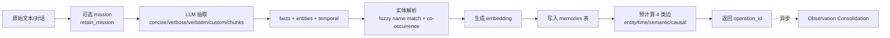
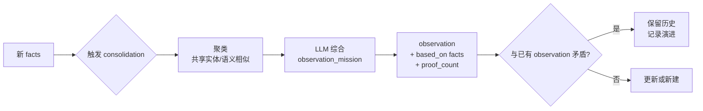
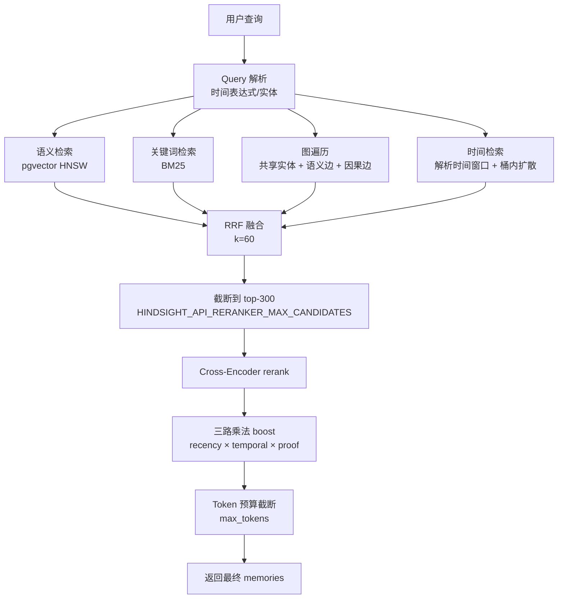
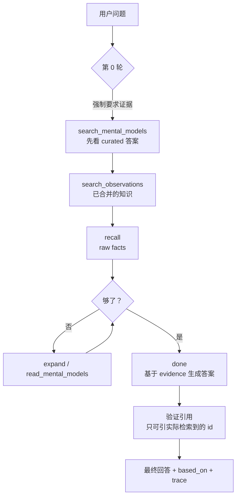

# Hindsight 架构深度解析：从数据流到实现机制

> 面向已经集成过 Hindsight、想理解内部运作机制的工程师。本文抓官网 `Retain / Recall / Reflect / Observations / Mental Models / Knowledge Pages / Multilingual / Performance / Storage / RAG vs Memory` 的核心信息，省略入门啰嗦部分。

**官方文档**：https://hindsight.vectorize.io/developer/  
**仓库**：https://github.com/vectorize-io/hindsight

---

## 目录

- [认知模型：Hindsight 在解决什么问题](#认知模型hindsight-在解决什么问题)
- [数据模型：一个 Memory Bank 里到底存什么](#数据模型一个-memory-bank-里到底存什么)
- [Retain：写入路径](#retain写入路径)
- [Observations：后台事实合并与去重](#observations后台事实合并与去重)
- [Recall：读取路径](#recall读取路径)
- [Reflect：Agentic 推理循环](#reflectagentic-推理循环)
- [Mental Models 与 Knowledge Pages：长寿命产物](#mental-models-与-knowledge-pages长寿命产物)
- [多语言：不是翻译，是 prompt 级路由](#多语言不是翻译是-prompt-级路由)
- [存储：为什么是 PostgreSQL + pgvector](#存储为什么是-postgresql--pgvector)
- [性能特征与调优点](#性能特征与调优点)
- [RAG vs Hindsight：本质差异](#rag-vs-hindsight本质差异)
- [参考资料](#参考资料)

---

## 认知模型：Hindsight 在解决什么问题

LLM 自身没有跨会话的长期记忆。常见的"伪记忆"做法是塞进 context window、或者把历史 dump 进向量库塞 prompt —— 这两种做法都有明显的天花板：

- **Context window**：有上限，会撞 token 限制；对长程事实会随距离衰减（lost-in-the-middle）。
- **朴素 RAG**：只能按相似度召回 chunks，没有时间维度、没有实体链接、没有矛盾处理、没有"该信哪个"的取舍。

Hindsight 的定位是 **biomimetic agent memory system**（仿生记忆系统），把对人类记忆的类比做成了工程化组件：

| 人类记忆机制 | Hindsight 对应组件 |
|---|---|
| 短时工作记忆 | Recall 返回的 top-k memories |
| 长期情景记忆 | Retain 持久化的事实 + 实体 + 链接 |
| 长期语义记忆（"我知道 X 是 Y"） | Observations（合并去重的稳定信念） |
| 内化知识（"我对某事的看法"） | Mental Models / Knowledge Pages |
| 性格倾向 | Disposition（skepticism / literalism / empathy） |
| 价值观硬约束 | Directives |

整个系统的设计目标：**读取快、写入可慢、知识会演化**。这与 RAG 强调"快速找到相关 chunk"的目标完全不同。

---

## 数据模型：一个 Memory Bank 里到底存什么

**Memory Bank**（记忆库）是隔离的最小单位 —— bank 之间不共享任何数据。隔离粒度选择：

- **每用户一个 bank**（最常见，隐私最干净）
- **每 agent 一个 bank**（agent 自身的知识）
- **单 bank + tags**（需要跨用户聚合分析时）

一个 bank 内同时存在 **5 种记忆类型**：

| 类型 | 谁产生 | 例子 | 持久位置 |
|---|---|---|---|
| `experience` 事实 | bank 自己的 agent 第一人称行为 | "我给 Bob 推荐了 Python" | `memories` 表 |
| `world` 事实 | LLM 从外部对话/文档中抽取 | "Alice 在 Google 工作" | `memories` 表 |
| `observation` | 后台 consolidation 合并多个 fact | "用户从 React 改投 Vue" | `observations` 表（带 `proof_count` 与证据 quote） |
| `mental_model` | 开发者创建，由 reflect 生成并自动 refresh | 团队沟通偏好文档 | `mental_models` 表（markdown + provenance） |
| `knowledge_page` | 开发者创建，本质是 mental_model 的 wiki 化包装 | `Architecture/Error-Handling.md` | 文件夹树 + 文件投影 |

除了以上 5 种主数据，还维护一个 **事件中心图（event-centric graph）** —— 这是 Hindsight 与传统 KG 的根本区别：

```
传统 KG（Hindsight 称之为 "map"）：
  [Alice] ──WORKS_AT──> [Google]
  ↑ 直接实体间关系；改现状要改写历史

Hindsight 的 "scrapbook" 模型：
  Memory 页面 "今天和 Alice 通话"  
    └─ 贴纸: [Alice] [Google] [research] [时间: 2024-03]
  Memory 页面 "下个月 Alice 跳槽"
    └─ 贴纸: [Alice] [Stark Industries] [时间: 2024-04]
  ↑ 实体不直接互连；共现于同一 memory 即关联
  ↑ 改现状只需新建页面，历史天然保留
```

这个设计意味着 **多跳推理是通过 memory 锚定同一实体节点** 来实现的，而不是传统的图遍历。

### 4 种记忆间的连接

Retain 时为每条事实建立 4 类边（**全部预计算**于写入时，而非查询时）：

| 边类型 | 用途 | 触发查询举例 |
|---|---|---|
| 实体连接 | 共享同一实体的事实 | "告诉我关于 Alice 的一切" |
| 时间连接 | 时间邻近的事实 | "那时还发生了什么" |
| 语义连接（kNN 预计算） | 嵌入空间近邻 | "类似主题的事实" |
| 因果连接 | 显式 `cause / enable / prevent` 关系 | "为什么发生这件事" |

### 两种时间维度

- **When it happened**：事件发生时间（"Alice 2024 年 6 月结婚"）
- **When you learned it**：写入系统的时间

**为什么需要两个？** 因为历史查询（"Alice 2024 干了啥"）和近因性排序（最近的事实优先）是两个不同的需求 —— 没有这个区分，要么老信息搜不到，要么老信息总被新信息压住。

---

## Retain：写入路径

`retain()` 是把原始文本变成可检索记忆的入口。本质是**一次 LLM 驱动的结构化抽取 + 异步 embedding + 同步建边**。



### 关键设计点

**1. 抽取模式（`retain_extraction_mode`）**

| 模式 | 用途 | LLM 调用 |
|---|---|---|
| `concise`（默认） | 通用、选择性、高吞吐 | 是 |
| `verbose` | 保留更丰富上下文与关系 | 是 |
| `verbatim` | 保留原 chunk 文本 + 仅 LLM 抽取元数据 | 是 |
| `custom` | 自写抽取规则 | 是 |
| `chunks` | 原始 chunk 直接存，不调 LLM | 否 |

**2. `retain_mission` 是什么**

```python
# 例：技术决策银行的 mission
retain_mission = """
Always include technical decisions, API design choices, and architectural trade-offs.
Ignore meeting logistics, greetings, and social exchanges.
"""
```

注入到 LLM 的抽取 prompt 里。**不替换抽取逻辑，只调整重点**。如果一个文档因 mission 收窄而抽出 0 个 facts，文档仍存储但不可被 recall —— 通过 `metrics` 与 `GET /documents` 的 `memory_unit_count: 0` 字段可以审计出来。

**3. `context` 字段决定 experience vs world 的归类**

```python
# agent 自己的日志 → experience
client.retain(bank_id, "我 patch 了 auth bug", context="The assistant is speaking")

# 第三方对话 → world
client.retain(bank_id, "我买了辆 Tesla", context="Customer Maria is speaking")
```

**经验与世界观事实的关键差别**：`experience` 优先级更高（agent 第一人称视角的事实往往更可信）、更可作为自指依据。

**4. 实体解析（Entity Resolution）**

同名异人、异名同人 —— 用 fuzzy 名字匹配 + 共现频次 + 时间邻近合并：

- `Alice` + `Alice Chen` + `Alice C.` → 同一个实体
- 但 `Alice` 不与 `Elizabeth` 合并（即使场景相似）
- **与上下文共现**：如果新 `Alice` 出现在与老 `Alice` 共现的实体旁 → 合并
- **会出错**：老 bank 里出现短名 + 高频共现，可能错把新实体吸进去。详细见文档 `How entity resolution decides`

**Entity Labels** 是受控词表：`key:value` 分类标签（`pedagogy:scaffolding`、`engagement:active`）。比普通实体更严格 —— 永远只做精确匹配，不参与模糊合并。可以设置 `tag: true` 让它自动写入 memory tags，从而用 tags 过滤。

**5. 内联附件（图片/截图/图表）**

`content` 可以传有序 block 列表（不是字符串），关键点：**位置对齐**让模型把图与上下文一起读：

```python
content = [
    {"type": "text",  "text": "重置 VPN 的步骤："},
    {"type": "image", "source": {"type": "base64", "media_type": "image/png", "data": "..."}},
    {"type": "text",  "text": "然后重连。"},
]
```

**重要细节**：
- 需要一个有 vision 能力的 LLM，单独通过 `HINDSIGHT_API_VLM_MODEL` 配置视觉槽（让纯文本 retain 走便宜模型，只有带图的才走视觉模型）
- 视觉模型不可用或不确定时 → 422 拒绝（不静默丢图）
- 批量 retain 走 `HINDSIGHT_API_RETAIN_BATCH_ENABLED=true` 时**不能**带附件（422 拒绝）
- 图表（柱状、表格）会被**逐项转写**（label + 数值 + 画法）成多个 facts，不做总结 —— 因为总结会丢数据

**6. 触发后台 Observation Consolidation**

Retain 完成后立即返回，**Consolidation 异步在后台跑**。`retain.completed` webhook 携带 `memory_unit_count` 用于判断是否抽到 facts。

**7. 时间处理**

每条 fact 同时记录 `event_date`（事实本身的时间）和 `ingestion_date`（写入时间）。没有 event date 的 fact（如"Alice 偏好 Python"）取中性 0.5 recency。

---

## Observations：后台事实合并与去重

Retain 只产生 raw facts，**合并成"稳定信念"是后台任务**。这是 Hindsight 与简单向量记忆最大的区别之一。



### Observation 的 5 大性质

1. **去重（deduplication）**：多条重叠 fact 合并成一条稳定信念
2. **证据锚定（grounding）**：每条 observation 指向它由哪些 fact + 原文 quote 得出
3. **演化（evolution）**：新证据来临时**精炼**而非覆盖，旧版本留在历史
4. **新鲜度感知（freshness）**：`reflect` 知道哪些 observation 已 stale
5. **效率**：合并后的浓缩知识更快召回

### 反直觉特性：观察矛盾的处理

```text
Week 1: "User loves React"          → "User prefers React for frontend"
Week 3: "User switched to Vue"      → "User was previously a React enthusiast...
                                        ...appreciated its component model,
                                        but has now switched to Vue and
                                        no longer uses React"
```

**不直接覆盖**。把"曾经的偏好 + 切换的事实"整合成一条新 observation。这种处理让 agent 不会向已经弃用 React 的人推荐 React 教程。

### Near-Duplicate Reconciliation

弱模型或多次 refresh 可能产生**几乎相同的两条** observation。默认开启去重（`HINDSIGHT_API_CONSOLIDATION_DEDUP_THRESHOLD=0.97`）：
- 余弦相似度 ≥ 阈值 → 触发"是否真的相同"的二次判断
- 不同的数字、否定、命名实体、语言 → **保留分开**
- 仅在 PostgreSQL 上跑（Oracle 跳过）

### Observation Scopes（关键设计）

`observation_scopes` 是 retain 时的参数，决定**同一批 memory 在哪些 tag 组合上独立建 observation**：

```python
# 常见模式：每用户独立建 observation
client.retain(bank_id, content, tags=["user:alice"])

# 共享模式：跨用户聚合（只有"全局"observation scope）
client.retain(bank_id, content,
              observation_scopes="shared",  # 一条全局 observation
              tags=["user:alice", "user:bob"])  # 各自的 fact tags 仍保留用于 recall 过滤
```

**`shared` 模式的典型陷阱**：如果你的 retain 给了 `tags=["session:xyz"]` 这种**每次调用都不同**的 tag，又开了 `observation_scopes: "shared"`，那么虽然 observation scope 是全局的，但你**永远**用一个空 tag 列表 match 不到它（"exact" 匹配时 scope 是 `[]`）。这种场景要么换 `observation_scopes: [[]]` + 内部 exact 匹配，要么用更稳定的 tag 维度。

### Consolidation Strategies（按 scope 分配策略）

不同 scope 用不同 mission / 容量限制：

```json
[
  {
    "scopes": [{"tags": ["company:*"]}],
    "observations_mission": "Record only general industry-level trends. Never name a specific company or person.",
    "max_observations_per_scope": 20
  },
  {
    "scopes": [{"tags": ["team:*"]}],
    "observations_mission": "Record decisions the team must act on."
  }
]
```

匹配规则：
- `scopes` 是 OR 关系，**每个 scope 内是 AND**
- `tags_match: "all"`（默认）允许额外 tag；`"exact"` 必须精确匹配
- 第一个匹配的 strategy 整体生效 —— 不会多 strategy 合并
- 永远无法 claim 空 tag scope（`["*"]` 也不行）
- 一个 strategy 什么都没设 → 直接被忽略

### Auto-Consolidation 关闭

`HINDSIGHT_API_ENABLE_AUTO_CONSOLIDATION=false` 后，需要手动：

```python
await client.banks.trigger_consolidation(
    bank_id=BANK_ID,
    consolidation_request=ConsolidationRequest(
        observation_scopes=[["user:alice"], ["team:eng"]]
    ),
)
# 不带 body = 全 bank sweep
```

适用于：批量 retain 完手动一次合并、调试、特定子集触发。

### 失效处理

| 动作 | 影响 |
|---|---|
| 删 document | 该 doc 派生的所有 observation 删除 |
| 删单个 memory（by type） | 来源 observation 删除 |
| 删整 bank | 全部 observation 删除 |
| `DELETE /memories/{id}/observations` | 清空某 memory 的 observation 贡献，触发重 consolidate |
| `clear_observations(bank_id)` | 清空整个 bank 的 observation，下一次 consolidation 重建 |

删除后剩余的 source memory 的 `consolidated_at` 被重置，下次会重新派生。

---

## Recall：读取路径

`recall()` 是 Hindsight 真正发力之处 —— **4 路并行检索 + 排名融合 + 神经 rerank**。



### 4 路检索各自负责什么

| 策略 | 解决 | 命中条件 |
|---|---|---|
| **语义** | "Alice's job" → "Alice is a software engineer" | 嵌入相似 |
| **关键词 BM25** | "Google" / "PostgreSQL" / "TensorFlow" 准确名 | 词项匹配 |
| **图遍历** | "Alice 的 manager 的 team" 这类多跳 | 共享实体 + 预计算语义边 + 因果边 |
| **时间** | "Alice 2023 干了啥" / "上周发生什么" | 时间窗口内 + 桶内扩散选择 |

**时间检索的细节**：当查询含时间表达式，解析为日期窗口；窗口内按**相关性**而非"最近"排序；同时**桶内扩散**（窗口划成时间桶，每桶取最相关的），避免"2023 干了啥"全返回 12 月。

### BM25 后端：5 种可插拔实现

| 后端 | 实现 | Citus 兼容 | 多语言 |
|---|---|---|---|
| `native`（默认） | PG `tsvector` + `ts_rank_cd`（实为 TF-IDF 非真 BM25） | ✅ | 仅欧语 + `simple` |
| `vchord` | `vchord_bm25` 扩展 | ❌ | 通过 `llmlingua2` |
| `pg_textsearch` | Timescale 扩展，硬编码英文 | ❌ | 仅英文 |
| `pgroonga` | `TokenBigram` + `NormalizerNFKC150` | ❌ | **✅ CJK 首选** |
| `pg_search` | ParadeDB，可配 tokenizer（`jieba`/`chinese_compatible`/`ngram` 等） | ✅ | ✅ |

**关键决策**：如果你的 bank 含 CJK 或多语，**`pgroonga`** 是默认推荐。`pg_search` 是 Citus 上的唯一真 BM25 选。

### 结果融合：RRF（Reciprocal Rank Fusion）

```text
score(d) = Σ  1 / (k + rank_i(d))   ，k=60
```

**为什么不是合并原始分数？** 因为四路分数量纲不同（cosine 0~1、BM25 0~∞、图激活 0~3），不可比较。RRF 只用排名，对量纲无关。

**权重相等**（默认）。如需偏向某路，用 `HINDSIGHT_API_RECALL_STRATEGY_BOOSTS` —— 在 RRF 之前 + rerank 之后做 rank-space 的偏置（除以 divisor），不是改 RRF 内部权重。

### Cross-Encoder Rerank

RRF 只看位置，没真读 query 和 memory。**Cross-encoder 把 (query, candidate) 整体读一遍**，输出真实相关性分数。

- 默认截断到 top-300 候选进 rerank（`HINDSIGHT_API_RERANKER_MAX_CANDIDATES`）
- 批大小：本地 32 对、TEI 128 对
- 分数在 [0,1] 区间**原样透传**（保留置信度），logits 才走 sigmoid
- **无 CE 时的兜底**：用 RRF 排名分配 [0.1, 1.0] 合成分数

### 三路乘法 Boost

```text
final_score = CE_normalized × recency_boost × temporal_boost × proof_count_boost
boost = 1 + α × (signal - 0.5)
```

| Boost | α | 最大调整 | 奖励什么 |
|---|---|---|---|
| Recency | 0.2 | ±10% | 线性 365 天衰减 |
| Temporal proximity | 0.2 | ±10% | 距查询时间窗中心近 |
| Proof count | 0.1 | ±5% | observation 的证据数对数归一 |

**为什么乘法？** 加法会被 recency 等次级信号喧宾夺主 —— 一个不太相关但很近的 memory 就能 leapfrog。乘法让 +10% 在高分上绝对值大、在低分上绝对值小，保证次级信号不压过 CE 的核心相关性。

**三 boost 极值叠加** ≈ ±23%~±27% —— **刻意保守**。

### Token 预算：agent 视角的 top-k

```python
# 默认 4096 tokens
results = client.recall(bank_id, query, max_tokens=8192, budget="high")
```

- `max_tokens` 控制**装多少 memory 文本到上下文**（按 token 计，不按条数）
- `budget` 控制**搜索深度**（low=100 / mid=300 / high=1000 召回预算）
- 二者**完全正交**：高 budget+低 tokens = 深度搜精选；低 budget+高 tokens = 浅搜广纳

| 场景 | budget | max_tokens |
|---|---|---|
| 聊天机器人 | low | 2048 |
| 文档问答 | mid | 4096 |
| 研究查询 | high | 8192 |
| 实时低延迟 | low | 2048 |

还有**自适应模式**（`HINDSIGHT_API_RECALL_BUDGET_FUNCTION=adaptive`）：让召回预算 = `max_tokens × ratio`，clamp 到 [20, 2000]。

### 拉原始 chunk 回看

memory 是 distilled 的，缺细节时可拉回原 chunk：

```python
results = client.recall(
    bank_id, query,
    include_chunks=True,
    max_chunk_tokens=512,
)
```

返回结构：
```json
{
  "text": "Alice prefers Python",
  "chunk": "Alice said she prefers Python... mainly because of its data science ecosystem...",
  "attachments": [...],
  "entities": [...]
}
```

### Recall 还能接受什么参数

```python
results = client.recall(
    bank_id, query,
    types=["world", "experience", "observation"],  # 控制返回的记忆类型
    tags=["user:alice"],
    tags_match="all_strict",   # 严格匹配，见 tags reference
    budget="mid",
    max_tokens=4096,
    include_chunks=False,
)
```

---

## Reflect：Agentic 推理循环

`recall()` 返回数据，`reflect()` 返回**答案**。本质是给 LLM 装上"自己的工具箱"，让它自己决定读什么、怎么读、如何回答。



**硬约束**：
- 最多 10 轮
- **必须先 gather evidence 才能 done**（防空回答）
- **只能引用实际检索到的 id**（防幻觉引用）

### 工具优先级：层级检索

1. **Mental Models**（curated 答案，命中即用）
2. **Observations**（合并知识）
3. **Raw facts**（底层事实）

`expand` 用于在某个 memory 上挖更深的 chunk/上下文。

### Disposition：影响解释方式的"性格"

3 个 1-5 的 trait：

| Trait | Low (1) | High (5) |
|---|---|---|
| **Skepticism** | Trusting | Skeptical，质疑 |
| **Literalism** | 灵活，会"读字里行间" | 字面，钉是钉铆是铆 |
| **Empathy** | 客观只讲事实 | 考虑情绪语境 |

加上一个 `reflect_mission` 字符串提供身份（"你是资深架构师，偏好简单而非前沿"）。

```python
client.create_bank("architect-bank", reflect_mission="""
    You're a senior software architect. Track system designs and tech decisions.
    Prefer simplicity over cutting-edge.
""", disposition_skepticism=4, disposition_literalism=4, disposition_empathy=2)
```

**关键事实**：disposition **只影响 reflect**，不影响 recall。同样的 facts 在不同 disposition 下会得到不同结论（官方文档给了"remote work"两段对比，非常直观）。

### Directives：硬规则

与 disposition 软影响不同，directive 是**必须遵循**的硬约束。例：

- "Never recommend specific stocks"（合规）
- "Never share PII with third parties"（隐私）
- "Always cite sources when making factual claims"（风格）

通过 tags scope 控制何时生效（untagged = 全局；tagged = 仅匹配时）。`apply_all_directives: true` 可强制全应用。

### Structured Output

```python
response = await client.reflect(
    bank_id, "How does Alice fit the research lead role?",
    response_schema={
        "type": "object",
        "properties": {
            "recommendation": {"type": "string"},
            "strengths": {"type": "array", "items": {"type": "string"}},
            "confidence": {"type": "number"},
        },
        "required": ["recommendation"],
    }
)
```

- **永远同时返回** `text`（prose）和 `structured_output`（typed object）
- 抽取失败时返回 200 + prose + `structured_output_error`（不静默）
- 抽取自**最终**答，不是中间推理

### 失败时怎么办

- 抽取失败 → 200 with prose only, no structured_output
- Reflect 整体超时 → `HINDSIGHT_API_REFLECT_WALL_TIMEOUT`
- 任何工具失败 → 重试 worker 默认 3 次（`HINDSIGHT_API_WORKER_MAX_RETRIES`）

---

## Mental Models 与 Knowledge Pages：长寿命产物

### Mental Models = 缓存的 reflect 答案

本质是把一次 reflect 的结果**持久化**，加自动刷新逻辑。下次 reflect 同一问题时，agent 工具调用可直接命中缓存。

```python
result = client.create_mental_model(
    bank_id=BANK_ID,
    name="Team Communication Preferences",
    source_query="How does the team prefer to communicate?",
    tags=["team", "communication"],
    trigger={
        "refresh_after_consolidation": True,  # 每次 consolidation 后重生成
        "min_refresh_interval_seconds": 1800,  # 限流：最少 30 分钟一次
        "mode": "delta",                       # 增量编辑而非全量重写
    },
)
```

**返回的是 `operation_id`** —— 实际生成是后台跑的。

### 两种刷新模式

| 模式 | 行为 | 适用 |
|---|---|---|
| `full`（默认） | 每次从头重新生成整篇 | 短文档、FAQ、需要重构输出时 |
| `delta` | 发出 `add_section/append_block/replace_block/...` 等操作 | 长寿命 playbook、只让变化部分动 |

**Delta 的精妙之处**：Hindsight 维护文档的**结构化 AST**（sections + blocks，每个 block 是原 markdown 片段），未触及的 block 字节级透传。这意味着多次 refresh 后**未改的格式不漂移**（表格不会变列表）。

**Delta 失败时的保守行为**：
- 所有操作都引用了不存在的 section/block → 询问一次重试
- 仍然找不到 → **整次 refresh 失败**，不写出不完整文档
- 累积 grounding：多次 refresh 的 `based_on` 合并去重

### Staleness Gating

每次自动 trigger 之前检查：**scope 内是否有 last refresh 之后的新 memory？**

- 没有 → 跳过本次 refresh（省一次 LLM 调用）
- "scope 内"严格按 `tags`/`tags_match`/`tag_groups`/`fact_types` 计算
- 删除操作**不**触发 staleness（写才有信号）
- `last_memory_seen_at`（看过的最新 memory 时间戳）vs `last_refreshed_at`（上次 refresh 完成时间）**是两个不同概念**：前者是数据位置、后者是墙钟

**关键坑**：untagged 写入**不会**让 tagged model 变 stale（`tags_match: any/all` 的隐式行为）—— 避免每次写入都触发全 rebuild。

### `min_refresh_interval_seconds` 的节流逻辑

```text
窗口内有 20 次 trigger → 折叠为 1 次 refresh（读那 20 次之间的所有新 memory）
```

trigger 不会被丢弃，是 parked 等待窗口关闭。手动 refresh（API/CLI/MCP）**绕过**节流，且会 release parked refresh。

### Knowledge Pages = Mental Model + Wiki 树

> "A knowledge page is a mental model with two additions: a place in a folder tree, and a set of defaults tuned for documents rather than answers."

区别：

| 维度 | Mental Model | Knowledge Page |
|---|---|---|
| 形态 | 问题的"答案" | 带 frontmatter 的 markdown 文档 |
| 组织 | 平铺，按 tags 过滤 | 嵌套文件夹 |
| 数据源 | 默认所有 fact type | **默认仅 observations** |
| 刷新 | 默认关闭 | 默认 consolidation 后 delta 刷新 |
| 典型消费者 | 应用或 agent 查找 | 人或 agent 浏览器式阅读 |

**关键不变量**：page 之间**从不互相读**，杜绝"两个 page 互相引用形成反馈环"。

`hindsight fs mount --bank my-bank` 把整个树投影为真实 markdown 文件（含 YAML frontmatter），让 `grep`、`rg`、`fzf`、editor 都能用。删除一个 page → **不影响**底层的 memory，下次会重新投影。

### API 详情对比

| List 端点 | Get 端点 |
|---|---|
| 默认返回 `metadata`（id/name/tags/is_stale/last_refreshed_at/last_memory_seen_at） | 默认返回 `full`（含 reflect_response） |
| `detail="content"` 加 source_query/content/trigger | `detail="content"` 不带 reflect_response |
| `detail="full"` 全量 | `detail="metadata"` 只取元数据 |

注意：**老版本 List 默认是 `full`** —— 升级后要明确传 `detail="content"` 才能拿到 content。

---

## 多语言：不是翻译，是 prompt 级路由

**核心原则**：Hindsight 不做翻译 —— prompt 级告诉 LLM 检测源语言并用同种语言抽取/回答。这样保留：

- 命名实体的原文（"张伟" 不会变成 "Zhang Wei"）
- 语用细微差别（"您" vs "你"）
- 行业术语

### 4 个组件都要配套多语言

默认 embedding `BAAI/bge-small-en-v1.5` 和 reranker `cross-encoder/ms-marco-MiniLM-L-6-v2` **只支持英文**。要让非英文工作良好：

| 组件 | 英文默认 | 多语言推荐 |
|---|---|---|
| **LLM** | 任何 | 必须支持目标语（GPT-4 / Claude / Gemini / Llama 3 均可） |
| **Embedding** | `bge-small-en-v1.5` | `BAAI/bge-m3`（100+ 语，最佳）；`intfloat/multilingual-e5-large`；`paraphrase-multilingual-MiniLM-L12-v2`（更轻量） |
| **Reranker** | `ms-marco-MiniLM-L-6-v2` | `BAAI/bge-reranker-v2-m3`（最佳）；`mmarco-mMiniLMv2-L12-H384-v1`（更轻） |
| **BM25 backend** | `native` | `pgroonga`（CJK 首选，单索引处理所有语言）；`pg_search`（Citus 兼容，可配 tokenizer） |

**`pgroonga` vs `pg_search`**：
- pgroonga：开箱即用，**内置 CJK 处理**（TokenBigram + NFKC150）
- pg_search：唯一 Citus 兼容的 BM25，但需要手动选 tokenizer

### `HINDSIGHT_API_LLM_OUTPUT_LANGUAGE`：强制单语输出

```bash
# 不管源语言，全部出英文
HINDSIGHT_API_LLM_OUTPUT_LANGUAGE=English

# 不管源语言，全部出西语
HINDSIGHT_API_LLM_OUTPUT_LANGUAGE=Spanish
```

适用 retain / consolidation / reflect 三阶段。**不设时**：默认保留源语言；observation 内的多语混合时，**多数语言**胜出；专有名词、术语、单位**永不翻译**。

### 单语 bank 的最佳实践

```bash
# 全西语 bank
HINDSIGHT_API_TEXT_SEARCH_EXTENSION=native
HINDSIGHT_API_TEXT_SEARCH_EXTENSION_NATIVE_LANGUAGE=spanish
HINDSIGHT_API_LLM_OUTPUT_LANGUAGE=Spanish
```

### CJK / 混合语 bank

```bash
HINDSIGHT_API_TEXT_SEARCH_EXTENSION=pgroonga
# 留 HINDSIGHT_API_LLM_OUTPUT_LANGUAGE 不设
```

**重要前置**：`pgroonga` / `pg_search` 是 PG 扩展，**不**随内置 `pg0` 一起打包 —— 必须在外部 PG 上安装，并通过 `HINDSIGHT_API_DATABASE_URL` 指向它。`pgroonga` 走 `docker/docker-compose/pgroonga/`。

---

## 存储：为什么是 PostgreSQL + pgvector

### 设计选择

Hindsight **没有**数据库抽象层（"no storage abstraction"）。官方理由：

> "PostgreSQL is becoming the standard database API. Its extension ecosystem and modularity mean that PostgreSQL-compatible interfaces are appearing everywhere — from serverless offerings to distributed databases."

支持多数据库会增加代码/测试/文档/运维复杂度，违背"开源 + 简单"的核心目标。

### PostgreSQL 提供的全部能力

| 能力 | 实现 |
|---|---|
| 向量检索 | pgvector + HNSW |
| 全文检索 | tsvector + GIN |
| 关系数据 | 原生 PG |
| JSON 文档 | JSONB + 索引 |
| 图查询 | 递归 CTE |

单库 = 单连接串、单备份策略、单监控、ACID 跨所有类型、单升级路径。

### Oracle AI Database 替代

企业级提供 **Oracle AI Database 完整功能等价** —— retain/recall/reflect 完全一致，drop-in。文档特别提到 reconciliation 在 Oracle 上**禁用**。

### pg0：内置嵌入式 PG

不设 `HINDSIGHT_API_DATABASE_URL` 时自动启动：
- 单二进制含 PG server + pgvector
- 端口 5555
- 数据存于 `~/.hindsight/pg0/`

**生产必须用外部 PG 15+**，且 pgvector ≥ 0.5.0。

### 经测试的托管服务

AWS RDS / Google Cloud SQL / Azure DB for PG / Supabase / Neon 均可。

### 为什么没有专门的向量数据库

Hindsight 团队选择 PG 是因为向量+全文+关系+图+JSON **强一致性**需求 —— 多系统拼接会失去事务边界，对知识图谱演化尤其致命。

---

## 性能特征与调优点

### 整体设计哲学：read fast, write slow

```text
Recall  : 100-600ms    瓶颈：reranker
Reflect : 800-3000ms   瓶颈：LLM 生成
Retain  : 500-2000ms/批  瓶颈：LLM fact extraction
```

读路径是 hot path（agent 用户面），写是后台或低峰期。10:1 以上的读写比是常态。

### Retain 性能

**关键洞察**：fact extraction 是结构化任务，**不需要 frontier model**。官方推荐 `gpt-oss-20b`（Groq 上有）。

加速手段：
1. **高吞吐 provider**（Groq > 标准云 API 的 RPM 限制）
2. **批**：单请求塞多少都行（仅受 HTTP payload 限制）
3. **异步**（自动批切分 + 并发）
4. **Provider Batch API**（OpenAI/Groq）→ 50% 成本，24h 延迟

### 本地/小环境调优

**核心问题**：默认 `HINDSIGHT_API_LLM_MAX_CONCURRENT=32` 假设云端吞吐；本地 LLM server 几个 slot 直接被打爆。

```bash
# 限并发
export HINDSIGHT_API_LLM_MAX_CONCURRENT=2

# 按操作分别限（retain/consolidation 不抢 reflect 资源）
export HINDSIGHT_API_RETAIN_LLM_MAX_CONCURRENT=1
export HINDSIGHT_API_CONSOLIDATION_LLM_MAX_CONCURRENT=1

# 长 timeout（首次有 model load 成本）
export HINDSIGHT_API_LLM_TIMEOUT=300
export HINDSIGHT_API_LLM_MAX_RETRIES=2  # 本地 retry 少做

# 小模型 + 低 reasoning
export HINDSIGHT_API_REFLECT_LLM_MODEL=<small-fast>
export HINDSIGHT_API_RETAIN_LLM_MODEL=<structured-output>
export HINDSIGHT_API_LLM_REASONING_EFFORT=low

# consolidation 批变小（默认 8）→ prompt 短，更稳
export HINDSIGHT_API_CONSOLIDATION_LLM_BATCH_SIZE=2
```

### 内置 llama.cpp provider

```bash
export HINDSIGHT_API_LLM_PROVIDER=llamacpp
export HINDSIGHT_API_LLM_MAX_CONCURRENT=2
export HINDSIGHT_API_LLAMACPP_GPU_LAYERS=-1     # -1 全 GPU；0 全 CPU
export HINDSIGHT_API_LLAMACPP_CONTEXT_SIZE=8192 # 调小省 RAM/VRAM
export HINDSIGHT_API_LLAMACPP_EXTRA_ARGS="--n_threads 8"
# export HINDSIGHT_API_LLAMACPP_NO_GRAMMAR=true # 更快但 JSON 不可靠
```

### Reranker 加速（CPU 是瓶颈）

```bash
# Apple Silicon (MPS) fp16 快 27-36%，质量不变
export HINDSIGHT_API_RERANKER_LOCAL_FP16=true
# 按长度排序再 batch，快 36-54%
export HINDSIGHT_API_RERANKER_LOCAL_BUCKET_BATCHING=true
# 控制并发
export HINDSIGHT_API_RERANKER_LOCAL_MAX_CONCURRENT=2

# 缩小 rerank 候选池（默认 300）
export HINDSIGHT_API_RERANKER_MAX_CANDIDATES=100

# 极端情况：换 flashrank（ONNX，更轻量）
export HINDSIGHT_API_RERANKER_PROVIDER=flashrank
```

### 数据库性能

- HNSW 索引做 ANN
- 100K facts 下向量查询 10-50ms
- 经测试到 millions facts/bank

### Recall budget → pipeline 参数

| budget | recall_budget（fixed） | semantic LIMIT | BM25 LIMIT | graph nodes | temporal nodes |
|---|---|---|---|---|---|
| low | 100 | 100 | 100 | 100 | 100 |
| mid | 300 | 300 | 300 | 300 | 300 |
| high | 1000 | 1000 | 1000 | 1000 | 1000 |

**Rerank 截断（300）独立于 budget** —— 由 `HINDSIGHT_API_RERANKER_MAX_CANDIDATES` 单独控制。

### 成本优化 checklist

- [ ] Retain 用 `gpt-oss-20b`（Groq）足够
- [ ] `HINDSIGHT_API_RETAIN_BATCH_ENABLED=true`（OpenAI/Groq，-50% 成本）
- [ ] `max_tokens` 按场景最小化
- [ ] Chunks 用 1000-2000 token 大块（不要很多小块）
- [ ] 简单查询用 `budget="low"`

### 监控

`/metrics` 暴露 Prometheus 指标。关键：
- `hindsight_recall_duration_seconds`
- `hindsight_reflect_duration_seconds`
- `hindsight_retain_items_total`

---

## RAG vs Hindsight：本质差异

| 维度 | 传统 RAG | Hindsight |
|---|---|---|
| 检索策略 | 单一语义相似 | 4 路并行（语义 + BM25 + 图 + 时间） |
| 多跳推理 | 受限于 chunk 内容 | 跨实体图遍历 |
| 时间查询 | 关键词匹配 | 时间表达式解析 + 范围过滤 + 桶内扩散 |
| 实体理解 | 无 | 实体解析 + 共现追踪 |
| 知识整合 | 无状态 | Observations + Mental Models（演化） |
| 个性化 | 无 | Disposition 3 trait + mission |
| 引用 | top-k chunks | verified 引用（只能引实际检索到的 id） |
| 多语 | 通常英文 | prompt 级语言路由 |

### 何时用哪个

| 场景 | 选 RAG | 选 Hindsight |
|---|---|---|
| 静态语料库文档问答 | ✅ | |
| 搜索无时间要求 | ✅ | |
| AI 助手需要持久记忆 | | ✅ |
| 实体追踪 | | ✅ |
| 一致性人格/性格 | | ✅ |
| 时间查询（"上个月"） | | ✅ |
| 多跳推理 | | ✅ |

### 关键架构差异

```text
RAG:      embed → vector search → top-k chunks → LLM
Hindsight: parse (time/entities) → 4 parallel → RRF → cross-encoder → boost → token budget → LLM (with disposition)
```

**最根本的不同**：Hindsight 维护**长期状态**（observations、mental models、entity graph），跨会话演化。RAG 是无状态的。

### 4 个典型场景对比

1. **多跳推理**：存了 Alice→Project Atlas→Kubernetes，RAG 查 "Was Alice affected by recent issues" 只返回 Alice 词条；Hindsight 经实体图 3 跳到 outage。
2. **时间查询**：存了 3 月开始微服务、4 月完成 auth、10 月专注性能，问 "What did Alice do last spring" —— RAG 返全部 Alice facts；Hindsight 解析为 3-5 月窗口。
3. **实体理解**：存了 Pro 订阅、移动 app 设置崩溃、改年付、桌面正常，问 "What do you know about my account" —— RAG 列无关联 facts；Hindsight 经实体图把它们绑到同一账户节点。
4. **知识演化**：第 1 周 struggle with async、3 周后上手 asyncio，RAG 无记忆；Hindsight 把 mental model 从 "user prefers sync" 精炼为 "user growing comfortable with async"。

---

## 关键概念速查（给已集成者的 mental model）

```text
                     ┌─────────────────────────────────────────────┐
                     │           Memory Bank (隔离)                 │
                     │                                              │
   retain()          │  ┌──────────┐    ┌────────────────────┐     │
   ─────────►        │  │  raw     │    │  observations      │     │
                     │  │  facts   │───▶│  (LLM 合并/去重)   │     │
                     │  │  +entities│    │  + evidence chain  │     │
                     │  │  +4 边  │    └────────────────────┘     │
                     │  └──────────┘                               │
                     │       │                │                    │
                     │       │  Recall()      │                    │
   4路并行 + RRF      │       ▼                ▼                    │
   + rerank + boost  │  ┌──────────────────────────────────┐     │
   ─────────►        │  │  Reflect (agentic loop)         │     │
                     │  │  - mental models (cached)        │     │
                     │  │  - observations                  │     │
   答案 + based_on   │  │  - raw facts                     │     │
   ─────────►        │  │  - disposition + mission         │     │
                     │  └──────────────────────────────────┘     │
                     │       │                │                    │
                     │       │  create_       │  create_          │
                     │       ▼                ▼                    │
                     │  ┌──────────┐    ┌────────────────────┐     │
                     │  │  mental  │    │  knowledge pages   │     │
                     │  │  models  │    │  (mental models +  │     │
                     │  │          │    │   wiki tree)       │     │
                     │  └──────────┘    └────────────────────┘     │
                     └─────────────────────────────────────────────┘
                                       │
                                       ▼
                              PostgreSQL + pgvector
                              (HNSW + tsvector + JSONB + CTE)
```

---

## 参考资料

- Hindsight 官方文档：https://hindsight.vectorize.io/developer/
- 仓库：https://github.com/vectorize-io/hindsight
- 论文：Hindsight is 20/20: Building Agent Memory that Retains, Recalls, and Reflects（arxiv 2512.12818）
- 基准：https://benchmarks.hindsight.vectorize.io/（LongMemEval 94.6%, LoComo 92.0%, BEAM-10M 64.1%）
- FAQ：https://hindsight.vectorize.io/faq
- 关键页：
  - Retain：https://hindsight.vectorize.io/developer/retain
  - Recall：https://hindsight.vectorize.io/developer/retrieval
  - Reflect：https://hindsight.vectorize.io/developer/reflect
  - Observations：https://hindsight.vectorize.io/developer/observations
  - Mental Models API：https://hindsight.vectorize.io/developer/api/mental-models
  - Knowledge Pages：https://hindsight.vectorize.io/developer/knowledge-pages
  - Multilingual：https://hindsight.vectorize.io/developer/multilingual
  - Performance：https://hindsight.vectorize.io/developer/performance
  - Storage：https://hindsight.vectorize.io/developer/storage
  - RAG vs Hindsight：https://hindsight.vectorize.io/developer/rag-vs-hindsight
